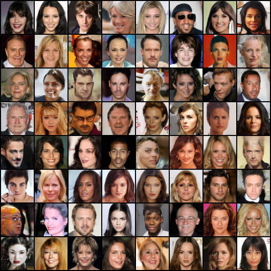
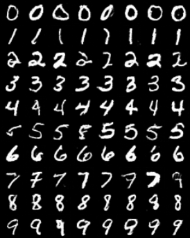

# Diffusion & Flow Lab

**Learn generative modeling by following an equation into code, an experiment, and a visualization.**

This laboratory connects diffusion models, score-based SDEs, flow matching,
rectified flows, optimal transport, and Brownian-reference Schrödinger bridges.
Start with two-dimensional Gaussian mixtures, where densities and scores are
known. Then use the same training and sampling interfaces on images.

Version 0.3 adds complete DDPM ELBO evaluation, numerical ODE likelihoods,
Gaussian-noise stochastic interpolants, improved consistency training,
progressive distillation, distribution precision/recall, latent diffusion and
adaLN-Zero DiT. Its configured training budgets and final evaluations completed.
[Extension results](docs/21_extension_results.md) distinguish final measurements,
earlier progress snapshots and invalidated implementation diagnostics.

Version 0.4 adds a [guided curriculum](docs/00_start_here.md), ten executable
[course notebooks](notebooks/README.md), a [shared equation-to-code notation reference](docs/23_notation_and_code.md),
[COCO text conditioning](docs/24_text_conditioning.md), and
[stronger evidence studies](docs/25_evidence_studies.md). Start with the curriculum;
the [current results and training status](docs/26_learning_and_text_results.md)
distinguish completed runs, integration checks and remaining quality gaps.

The [COCO scratch-denoiser and CIFAR refinement study](docs/28_scratch_and_refinement.md)
has completed its configured training/evaluation budgets. See the report for observed quality; the reported LoRA experiment
uses a pretrained denoiser and remains a separate baseline.

The implementation makes process coefficients, prediction targets, time
directions, guidance, and integration rules visible. It is an educational
implementation of published methods, rather than a claim of algorithmic novelty.

*Both panels start from the same particles and use the analytic GMM score.
Probability-flow ODE and reverse SDE have matching time marginals in the exact
limit, but different trajectories. Numerical and Monte Carlo errors remain.*

## Final trained examples

The CIFAR diffusion, CIFAR flow, and face flow runs each completed 100,000
optimizer steps. The following scores come from their saved final checkpoints:

| Model and sampler | Generated / reference images | FID ↓ | IS ↑ | Network calls/image |
|---|---:|---:|---:|---:|
| [CIFAR-10 EDM, CFG 1.5, 18-step Heun](assets/experiments/cifar10/cifar10_edm_cfg_final/metrics.json) | 10,000 / 10,000 | 8.97 | 8.96 | 70 |
| [CIFAR-10 DiT, CFG 1.5, 18-step Heun](assets/experiments/cifar10/cifar10_dit_cfg_final/metrics.json) | 10,000 / 10,000 | 8.93 | 9.27 | 70 |
| [CIFAR-10 flow, CFG 1.5, 50-step Heun](assets/experiments/cifar10/cifar10_flow50_final/metrics.json) | 10,000 / 10,000 | 10.00 | 9.13 | 200 |
| [Face flow, 50-step Heun](assets/experiments/faces/celeba_flow_final/metrics.json) | 10,000 / 2,000 | 16.31 | — | 100 |
| [128px latent face DiT, 18-step Heun](assets/experiments/faces/celeba128_latent_dit_final/metrics.json) | 10,000 / 2,000 | 23.72 | — | 35 |

The CIFAR rows show classes in dataset order, with the first eight generated
examples per class. Face samples show the first 64 outputs. These are saved
model outputs, with no selection for visual quality. The official CIFAR test
split was also used during development, and the face reference is smaller;
read the [metric protocol](docs/12_image_experiments.md) before comparing scores
with papers. [Advanced results](docs/14_advanced_results.md) also include
one/few-step consistency generation, interpolation, and weaker baselines.

Progressive distillation now reduces a 32-call MNIST teacher to one network
call. On 2,048 generated/held-out digits, requested-class accuracy is 96.3%
and independent digit feature distance is 47.3 (teacher: 95.7%, distance 44.2).
This distance uses a digit classifier, not Inception FID.

The [extension evidence](docs/21_extension_results.md) includes complete ELBO
decompositions, analytic likelihood checks, learned interpolant animations,
distribution coverage and latent reconstructions. DiT and both latent models
completed 100,000 updates; corrected iCT completed 40,000. One-call iCT reaches
96.1% class accuracy and digit feature distance 43.6; four-call iCT reaches
96.5% and 40.8. The two earlier iCT runs were invalidated by an autocast
gradient-cache bug and remain explicitly labeled diagnostics.

CIFAR consistency distillation reaches FID 22.22 in one call, but the default
two/four-call refinement worsens FID to 69.57/83.41. Those configurations require
further investigation. Face generators also retain visible artifacts. The
[repository audit](docs/22_repository_audit.md) records remaining quality,
evaluation and release work; completed budgets do not guarantee strong samples.

## Text-conditioned examples

COCO 2017 is fully downloaded and decoded at the configured image-data root:
118,287 training and 5,000 validation images. The 512px text experiment adapts a
local pretrained SD2-family U-Net with 1.66M LoRA parameters, frozen text/VAE
components and 3,000 updates (24,000 training pairs). It includes native token
cross-attention, caption dropout, text CFG and target-specific Min-SNR weights.

On 256 matched held-out captions, independent CLIP cosine is 0.2591 for the
pretrained base and 0.2647 after adaptation; the paired difference is +0.0056
with a caption-wise 95% interval [0.0026, 0.0086]. This is a single fine-tuning
run and a broad alignment diagnostic. The six controlled caption preferences
are correct for both models, while some anatomy and scene-binding errors remain.
[Text theory and commands](docs/24_text_conditioning.md) and
[measured results](docs/26_learning_and_text_results.md) include the CFG 0/1/3/5/7.5
sweep, raw galleries, exact prompts and checkpoint/base hashes. Separately, our
compact text U-Net completed 100,000 updates from random denoiser initialization
with frozen pretrained VAE/text components. Its [final galleries and evaluation](docs/28_scratch_and_refinement.md)
show remaining anatomy, counting and spatial-relation failures; it has not met
the showcase-quality goal.

## Learning path

Follow [Start here](docs/00_start_here.md) for the lesson sequence, prerequisites,
notebooks and [worked exercises](docs/exercises.md). The table below is the full
reference library; it does not require reading every advanced chapter first.

Basic Python/PyTorch, vectors, derivatives, Gaussian distributions, and
conditional expectation are useful prerequisites. The first chapter introduces
the notation and explains how these ingredients are used.

| Read in order | Learn | Implementation | Visual example |
|---|---|---|---|
| [1. Foundations](docs/01_foundations.md) | Density, score, SDE, ODE, Fokker–Planck, continuity | [paths](diffusion_lab/paths.py), [lessons](diffusion_lab/lessons.py) | [Density equations](assets/teaching/gaussian_diffusion/density_equations.png) |
| [2. Diffusion](docs/02_diffusion.md) | VP/VE, schedules, Tweedie, targets, DDPM/DDIM | [targets](diffusion_lab/targets.py), [sampling](diffusion_lab/sampling.py) | [Score and denoising](assets/teaching/gaussian_diffusion/score_tweedie.png) |
| [3. Flows and OT](docs/03_flows_and_transport.md) | Conditional/marginal velocity, rectification, reflow | [training](diffusion_lab/train.py), [transport](diffusion_lab/transport.py) | [Endpoint couplings](assets/teaching/gaussian_diffusion/ot_couplings.png) |
| [4. Guidance](docs/04_guidance.md) | Conditional generation, CFG, noisy classifiers | [guidance](diffusion_lab/guidance.py), [evaluation](diffusion_lab/evaluate.py) | [Guidance gallery](docs/08_results.md) |
| [5. Solvers](docs/05_numerical_methods.md) | Euler, Heun, RK4/RK45, EM, stochastic Heun, PC | [solvers](diffusion_lab/solvers.py) | [Accuracy and variance](assets/teaching/gaussian_diffusion/solver_accuracy.png) |
| [6. Bridges](docs/06_bridges.md) | Entropic OT, Brownian bridges, Markovian matching | [bridges](diffusion_lab/bridges.py) | [Entropic bridge paths](assets/teaching/gaussian_diffusion/entropic_bridges.png) |
| [7. Experiment practice](docs/07_experiments_and_metrics.md) | Hydra, datasets, validation, metrics | [training](diffusion_lab/train.py), [metrics](diffusion_lab/metrics.py) | [Saved results](assets/metadata/results.json) |
| [8. Results](docs/08_results.md) | Actual trained runs and their limits | [asset exporter](scripts/export_assets.py) | Samples, curves, GIFs |
| [9. Advanced diffusion](docs/09_advanced_diffusion.md) | Sub-VP, log-SNR, learned variance, EDM, fast solvers | [EDM](diffusion_lab/edm.py), [Improved DDPM](diffusion_lab/improved_ddpm.py) | [Extended schedules](assets/teaching/transport/extended_schedules.png) |
| [10. Consistency](docs/10_consistency_models.md) | Standalone training, teacher distillation, one/few-step sampling | [consistency](diffusion_lab/consistency.py) | Image experiments |
| [11. Iterative bridges](docs/11_iterative_bridges.md) | Alternating forward/backward fitting and endpoint replay | [DSBM](diffusion_lab/dsbm.py) | Per-iteration plots and GIFs |
| [12. Image practice](docs/12_image_experiments.md) | CIFAR/MNIST, custom data/models, guidance, interpolation, checkpoints | [image trainer](diffusion_lab/image_train.py) | Class galleries and interpolation strips |
| [13. Visual transport](docs/13_visual_transport.md) | Rich labeled 2D data, crossing paths, reflow, moving mass | [toy data](diffusion_lab/toy_data.py), [advanced lessons](diffusion_lab/advanced_lessons.py) | [Toy gallery](assets/teaching/transport/toy_datasets.png) |
| [14. Advanced results](docs/14_advanced_results.md) | Measured image quality, solver cost, consistency and alternating bridges | [comparison runner](scripts/run_quality_comparisons.py) | Trained class galleries and interpolation |
| [15. Coverage and scope](docs/15_coverage_and_scope.md) | Where each concept is implemented and what its evidence establishes | [Validation report](assets/metadata/validation.json) | Method-by-method evidence map |
| [16. Likelihood and ELBO](docs/16_likelihood_and_elbo.md) | Complete DDPM bound, ODE density, divergence, dequantization | [likelihood](diffusion_lab/likelihood.py) | Analytic GMM check and full MNIST decomposition |
| [17. Stochastic interpolants](docs/17_stochastic_interpolants.md) | Endpoint paths, conditional velocity/score, matching ODE/SDE marginals | [interpolants](diffusion_lab/interpolants.py) | Learned class-colored GMM/rings/spiral GIFs |
| [18. Stronger few-step generation](docs/18_stronger_few_step_generation.md) | Online-target iCT and progressive two-to-one distillation | [progressive](diffusion_lab/progressive.py), [consistency](diffusion_lab/consistency.py) | Measured teacher/student cost and quality |
| [19. Evaluation beyond FID](docs/19_evaluation_beyond_fid.md) | Precision/recall, density/coverage, class diagnostics, neighbors, uncertainty | [distribution metrics](diffusion_lab/distribution_metrics.py) | Independent seed intervals and nearest-image galleries |
| [20. Latent diffusion and DiT](docs/20_latent_diffusion_and_dit.md) | Frozen posterior caches, whitening, patch tokens, adaLN-Zero | [latent codec](diffusion_lab/latents.py), [DiT](diffusion_lab/dit.py) | 128px reconstruction and generated-image examples |
| [21. Extension results](docs/21_extension_results.md) | Actual evidence and current training status | [report builder](scripts/build_extension_results.py) | Updated measured tables and labeled progress previews |

Each chapter connects a derivation, code, command, figure interpretation, and
exercise. Analytic mathematical examples and learned examples are labeled.

## Setup

Python 3.10+ is required. CPU is supported; image training benefits from CUDA.
In the existing environment:

~~~bash
conda activate simple_udm
cd Diffusion
python -m pytest -q
python -m diffusion_lab.lessons --output assets/teaching/gaussian_diffusion
~~~

For a fresh environment, install matching PyTorch/torchvision builds using the
[official instructions](https://pytorch.org/get-started/locally/), then:

~~~bash
python -m pip install -e ".[dev,metrics]"
# Optional frozen AutoencoderKL support for latent experiments.
python -m pip install -e ".[latent]"
# Caption training and the interactive course:
python -m pip install -e ".[text,notebooks]"
~~~

Run the teaching and asset scripts from the repository root. Hydra YAML files
have one source in configs and are included in built wheels, so the training
module also works after ordinary installation. Image metrics require torchmetrics,
torch-fidelity, and pretrained torch-fidelity Inception weights in the PyTorch
cache (or network access for their first download). GIFs use Pillow.
Training does not automatically download data or pretrained generative models.

## Your first experiment

~~~bash
# Clean-data prediction on an eight-component Gaussian mixture.
python -m diffusion_lab.train device=cpu process.prediction=x0 \
  steps=3000 run_dir=outputs/my_first_diffusion

# Flow matching on the same distribution.
python -m diffusion_lab.train experiment=gmm_flow device=cpu \
  steps=3000 run_dir=outputs/my_first_flow
~~~

Open samples.png, generation.gif, loss.png, and metrics.json in each run.
Regression loss need not reach zero: the least-squares optimum averages
different endpoints/noise draws compatible with the same observed state.

For GMM noise prediction, start with process.schedule=linear. The cosine
schedule's tiny terminal signal coefficient amplifies epsilon prediction errors
when reconstructing x0. Compare x0 and v targets. Image samplers can clip the
estimated clean image to [-1,1]; GMM samples must not use that image-specific clip.

## Implemented components

| Component | Choices |
|---|---|
| Discrete diffusion | DDPM ancestral sampling; DDIM with eta; full or respaced VP grids |
| Discrete schedules | Scaled linear beta; cosine cumulative signal variance; log-SNR; exponential |
| Continuous diffusion | VP, VE, sub-VP; linear beta, cosine, log-SNR and exponential schedules |
| Prediction targets | epsilon, x0, score, diffusion v; algebraic conversions |
| Continuous samplers | Reverse SDE, probability-flow ODE, Langevin predictor–corrector |
| Flow matching | Linear/trigonometric paths; independent/minibatch OT coupling |
| Rectified flow | Linear conditional flow matching; teacher-generated endpoint reflow |
| Bridges | Log-domain Sinkhorn, Brownian bridges, Markovian projection, alternating 2D DSBM-IMF/IPF |
| Advanced diffusion | Learned diagonal variance, hybrid/VLB objectives, adaptive timestep sampling, EDM |
| Fast generation | DPM-Solver / DPM-Solver++ first/second order; consistency CT/CD/iCT; progressive DDIM distillation |
| Stochastic interpolants | Linear/trigonometric/cubic endpoint paths with Gaussian bridge noise; velocity/noise heads; tunable ODE/SDE |
| Likelihood | Full DDPM negative ELBO; unbiased sampled transition sum; exact/Hutchinson ODE divergence with Euler/Heun/RK4 |
| Guidance | Class embeddings, null token, label dropout, CFG, trained noisy classifiers |
| Networks | Residual time-conditioned MLP; compact teaching U-Net; multi-block FiLM U-Net; configurable adaLN-Zero DiT |
| Latent generation | Frozen AutoencoderKL posterior cache, train-only whitening, U-Net/DiT denoisers, decoded RGB evaluation |
| Training | AdamW, gradient clipping, EMA, fixed validation noise, optional BF16, DDP |
| Data | GMM; eleven labeled 2D geometries; MNIST/CIFAR-10; arbitrary flat or labeled image folders |
| Metrics | Unbiased RBF MMD², sliced W2, bounded exact empirical W2, mode diagnostics, Inception FID/KID/IS, precision/recall, density/coverage, per-class and nearest-neighbor diagnostics, generation-seed intervals |

Flow velocity and diffusion v are different targets. Schedules, process families
and prediction targets belong to different layers. Bridge examples include a
finite-support lesson and separate alternating neural 2D DSBM training. Method
coverage does not imply reproduction of every paper's architecture or scores.

## Hydra experiments

~~~bash
python -m diffusion_lab.train experiment=gmm_vp sampler=sde
python -m diffusion_lab.train experiment=gmm_vp \
  process.kind=vp_cosine process.prediction=v
python -m diffusion_lab.train experiment=gmm_ve
python -m diffusion_lab.train experiment=gmm_flow \
  process.coupling=ot batch_size=128
python -m diffusion_lab.train experiment=gmm_guidance process.prediction=x0 \
  run_dir=outputs/gmm_guidance
python -m diffusion_lab.train experiment=gmm_bridge
python -m diffusion_lab.train experiment=gmm_bridge \
  process.prediction=velocity sampler=ode

# Train the teacher before reflow.
python -m diffusion_lab.train experiment=gmm_flow run_dir=outputs/gmm_flow
python -m diffusion_lab.train experiment=gmm_reflow

# Inspect configuration or sweep independent seeds.
python -m diffusion_lab.train --cfg job --resolve experiment=gmm_flow
python -m diffusion_lab.train --multirun seed=0,1,2 process.prediction=x0
~~~

Run only one process per run directory. Defaults contain the seed but do not
encode every override; give comparisons their own run_dir.

## Image data

IMAGE_DATA_ROOT defaults to /data/tii/Image_data. Override data.root or set that
environment variable on another machine. Expected layouts:

~~~text
celeba_hq_256/images/{train,validation}/*.png
ffhq_256/images/train/*.png
imagenet_1k_256/images/{train,validation}/class_0000/*.jpg
~~~

CelebA and ImageNet use their local train/validation splits. FFHQ has an explicit
deterministic shuffled held-out fraction because this mirror has only train.
ImageNet conditioning uses folder labels. Bounded selections visit classes
round-robin. Face metadata is not automatically used as a class label.

~~~bash
python -m diffusion_lab.train experiment=celeba_ddpm
python -m diffusion_lab.train experiment=celeba_flow
python -m diffusion_lab.train experiment=celeba_ddpm data=ffhq
python -m diffusion_lab.train experiment=imagenet_conditional

# Larger images and all local training images; requires more compute.
python -m diffusion_lab.train experiment=celeba_ddpm \
  data.image_size=64 data.train_limit=0 data.validation_limit=0 \
  model.width=64 batch_size=32 steps=50000
~~~

Initial image presets use 32×32 images and bounded training subsets. They are
teaching baselines, not pretrained production generators.

## Three GPUs

For the larger image toolkit, use the separate image_train configuration:

~~~bash
# Full CIFAR-10, class conditioning and null-token dropout for CFG.
python -m diffusion_lab.image_train data=cifar10 algorithm=edm \
  steps=100000 run_dir=outputs/cifar10_edm_quality

# Grayscale digits with a smaller multi-block U-Net.
python -m diffusion_lab.image_train data=mnist model.width=32 \
  model.channel_mult='[1,2,2]' model.attention_levels='[2]' \
  steps=20000 run_dir=outputs/mnist_edm_quality

# Learned diagonal reverse variance; six channels for RGB.
python -m diffusion_lab.image_train algorithm=improved_ddpm \
  learned_variance=true model.out_channels=6 objective=hybrid
~~~

See [image practice](docs/12_image_experiments.md) for custom folders/models,
classifier/CLIP guidance, interpolation, metric protocols and resume. See
[Slurm templates](slurm/README.md) for cluster jobs. The automatically refreshed
[training status](assets/metadata/training_status.json) distinguishes saved progress from
completed training budgets; saved previews do not imply benchmark readiness.

Independent runs:

~~~bash
python scripts/run_research_suite.py --gpus 0 1 2
~~~

The suite runs GMM target, process, coupling, reflow, and bridge comparisons,
writes process.log per run, and skips completed jobs. Its reflow teacher must
already exist at outputs/gmm_flow/checkpoint.pt.

Distribute a single image training job:

~~~bash
torchrun --standalone --nproc_per_node=3 -m diffusion_lab.train \
  experiment=celeba_ddpm run_dir=outputs/celeba_ddp
~~~

batch_size is per rank. Rank zero writes artifacts and evaluates.

## Resample and compare

~~~bash
python -m diffusion_lab.evaluate \
  --checkpoint outputs/gmm_guidance/checkpoint.pt \
  --output outputs/conditional_cfg --device cuda:0 \
  --class-label 0 --guidance cfg --scale 2

python -m diffusion_lab.evaluate \
  --checkpoint outputs/gmm_guidance/checkpoint.pt \
  --output outputs/conditional_classifier --device cuda:0 \
  --class-label 0 --guidance classifier --scale 1

python -m diffusion_lab.evaluate \
  --checkpoint outputs/gmm_ddpm_x0/checkpoint.pt \
  --output outputs/ancestral --method ddpm --steps 1000

python scripts/run_comparisons.py --device cpu
python scripts/export_assets.py
~~~

Conditional evaluation uses the requested component/class as reference. CFG
scale zero uses the unconditional reference.

## Layout and artifacts

~~~text
diffusion_lab/       Mathematical components and runnable entrypoints
configs/            Hydra data/model/process/sampler/experiment groups
docs/               Guided explanations, derivations, exercises, references
tests/              Scientific invariants, convergence, and configuration checks
scripts/            Experiment suite, comparisons, asset export
notebooks/          Ten guided lessons with equations, exercises and executed visuals
slurm/              Configurable cluster job templates
assets/teaching/    Concept plots and animations by lesson family
assets/experiments/ Generated samples, configs and metrics by dataset
assets/studies/     Controlled comparisons and declared prompts
assets/reports/     Validation and assessment diagnostics
assets/metadata/    Inventories, checkpoint hashes and status reports
assets/archive/     Historical training previews
outputs/            Checkpoints, sampled tensors, logs (Git-ignored)
legacy/             Borrowed reference source (only README is public)
.local/             Historical session helpers and scratch work (Git-ignored)
~~~

Runs save config.yaml, environment.json, history.json, checkpoint.pt (model,
EMA, optimizer, step, config), metrics.json, loss.png, samples.png,
generation.gif, and samples.pt. Conditional diffusion can also save classifier.pt.
resume continues weights, EMA, optimizer, and step. The image trainer also
restores RNG states and sampler position; CPU continuation is checked for exact
agreement, including persistent workers. CUDA runs can still differ numerically.
The original teaching trainer does not promise identical draws after restart.

Asset export omits large checkpoints and raw datasets. Start with the
[visual showcase and folder guide](assets/README.md). See
[the original baseline gallery](docs/08_results.md) and
[advanced results](docs/14_advanced_results.md).

The [script index](scripts/README.md) explains the reusable experiment and audit
tools. The [publication guide](docs/27_publication.md) defines the public file
set. `outputs/`, datasets, caches, raw tensors, model/optimizer weights, logs,
local completion helpers and borrowed reference source are Git-ignored. Curated
figures, animations, metric protocols, configs and checkpoint hashes stay in
`assets/`. Ignore rules keep files on disk; they do not remove files already
tracked in Git.

~~~bash
python -m scripts.check_publication
python -m scripts.check_docs
python -m scripts.review_public_assets
~~~

## Evaluation and correctness

[Read the metric protocol](docs/07_experiments_and_metrics.md) before comparing
numbers. Image FID uses pretrained 2048-dimensional Inception features; IS does
not compare with real data. Unbiased KID and MMD² estimates may be negative.
Original teaching runs use 128 real and 128 generated samples. Advanced CIFAR
evaluations use 10,000 generated images and all 10,000 test images; MNIST solver
comparisons use 2,048 images and a separate digit feature metric. The saved
metadata records each protocol, checkpoint hash and measured network cost.

Tests check analytic score gradients, target conversions, SDE moments, ODE
convergence, stochastic variance, discrete clean endpoints, Brownian bridge
covariance, Sinkhorn marginals, guidance, model shapes, and Hydra composition.
The lessons also record finite-difference PDE residuals.

The [saved validation report](assets/metadata/validation.json) records the tested
environment, passing scientific tests, three-GPU DDP smoke run, and wheel
installation check. The [baseline gallery](docs/08_results.md) and
[advanced gallery](docs/14_advanced_results.md) include actual measured runs,
conditional samples, faster solvers and consistency generation.

The new package is an original implementation. The unused legacy reference came
from a friend; see [its provenance note](legacy/README.md) before publishing it.
Data is read in place and not bundled. Primary papers and implementation scope
are documented in [references](docs/references.md).

The [publication review](docs/PUBLICATION_REVIEW.md) records completed training,
sample quality, checks, and the remaining license/checkpoint release tasks.
