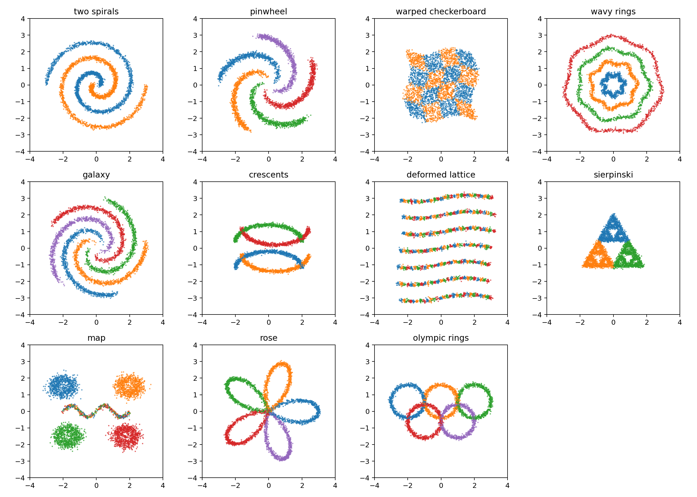
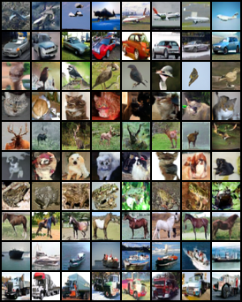
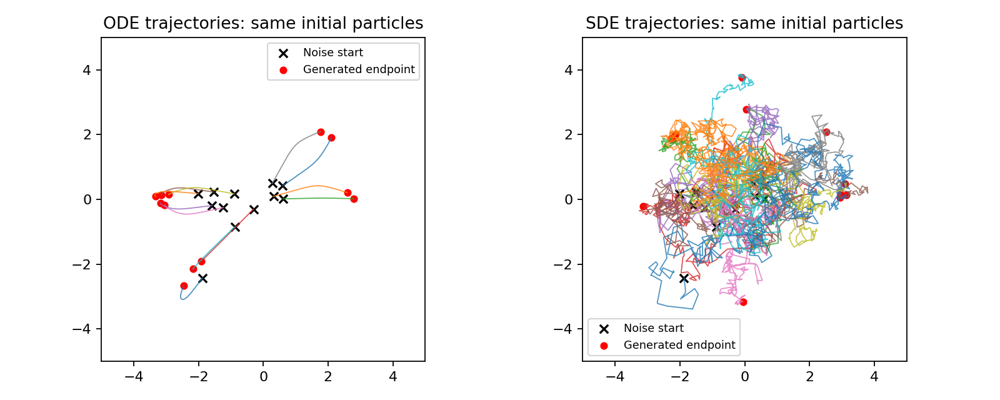

# Visual showcase and experiment evidence

Start here to see the project without running training. Teaching figures,
representative generated images and their measured reports are public.
Model weights, raw sample tensors and datasets remain outside `assets/`.

## Selected examples

These are selected **experiments**, with the original representative sample grids.
Individual successful images have not been picked out of their grids.

| Example | Visual | Explanation and measurements |
|---|---|---|
| Noise, scores and diffusion trajectories | [ODE/SDE paths](teaching/gaussian_diffusion/ode_sde_trajectories.png) · [ODE GIF](teaching/notebooks/02_probability_flow.gif) · [SDE GIF](teaching/notebooks/02_reverse_sde.gif) | [Scores and dynamics lesson](../notebooks/02_scores_sdes_and_odes.ipynb) |
| Labeled 2D datasets and transport | [Dataset gallery](teaching/transport/toy_datasets.png) · [Reflow](teaching/transport/reflow_mass.gif) | [Visual transport](../docs/13_visual_transport.md) |
| CIFAR-10 class-conditioned EDM | [Class grid](experiments/cifar10/cifar10_edm_cfg_final/classes.png) | [FID 8.97, 10k/10k protocol](experiments/cifar10/cifar10_edm_cfg_final/metrics.json) |
| CIFAR-10 class-conditioned DiT | [Class grid](experiments/cifar10/cifar10_dit_cfg_final/classes.png) | [FID 8.93, 10k/10k protocol](experiments/cifar10/cifar10_dit_cfg_final/metrics.json) |
| CIFAR-10 flow matching | [Class grid](experiments/cifar10/cifar10_flow50_final/classes.png) | [FID 10.00, 10k/10k protocol](experiments/cifar10/cifar10_flow50_final/metrics.json) |
| One-call MNIST distillation | [Class grid](experiments/mnist/mnist_progressive_1_eval/classes.png) | [Few-step evidence](../docs/18_stronger_few_step_generation.md) |
| Face flow and latent interpolation | [Samples](experiments/faces/celeba_flow_final/samples.png) · [Latent DiT interpolation](experiments/faces/celeba128_latent_dit_final/interpolation.png) | [Latent models](../docs/20_latent_diffusion_and_dit.md) |
| Controlled text changes | [Matched-noise prompt contrasts](studies/text_gallery/prompt_contrasts.png) | [Pretrained base and LoRA adaptation](../docs/26_learning_and_text_results.md) |

The class grid shows the first eight outputs per class. Recognizable structure
does not mean every image is artifact-free. The CIFAR test split was used during
development; face references are smaller. Read the
[metric protocol](../docs/12_image_experiments.md) before comparing with papers.
Text contrasts use a pretrained base/LoRA adapter; the separate scratch-denoiser
and weak consistency-refinement results are in the
[final study](../docs/28_scratch_and_refinement.md).

## Folder guide

| Folder | What belongs here |
|---|---|
| [teaching/](teaching/README.md) | Concept plots and animations, grouped by lesson family |
| [experiments/](experiments/README.md) | Generated images, configs and metrics grouped by dataset or topic |
| [studies/](studies/README.md) | Controlled comparisons, text prompts, training-seed and refinement studies |
| [reports/](reports/README.md) | Validation, dataset verification, classifier and distribution diagnostics |
| [metadata/](metadata/README.md) | Experiment inventory, checkpoint hashes, validation summaries and status records |
| [archive/](archive/README.md) | Historical training previews used by the results narrative |

Interim, weak and invalidated evidence remains available with its original
labels. Directory grouping is for navigation and does not certify a run.
Historical local paths in the [checkpoint manifest](metadata/checkpoints.json)
record provenance; they are not public download links.

## Maintenance

`python -m scripts.export_assets` refreshes selected local evidence into the
organized layout. `python -m scripts.build_asset_index` rebuilds dataset indexes.
`python -m scripts.check_docs` checks publication links, and
`python -m scripts.review_public_assets` decodes PNG/GIF files and measures the
publication footprint. These commands do not publish remotely.
