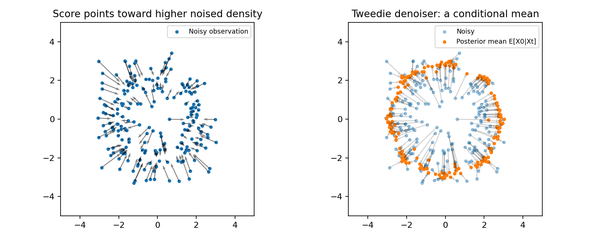
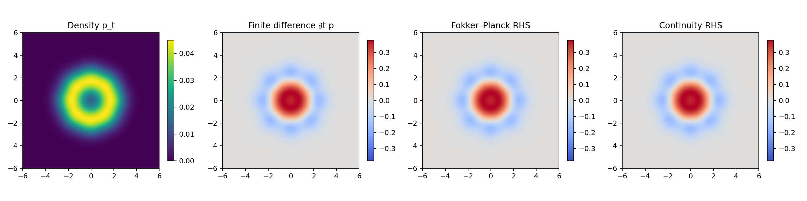

# 1. From particles to probability distributions

## The generative modeling task

A generative model produces new observations with a distribution similar to a
dataset. In our first example, eight Gaussian clouds sit around a circle.
Sampling standard Gaussian noise is easy; transporting it into those clouds
is the task.

[GaussianMixture](../diffusion_lab/data.py) uses component means μ_k, covariance
τ²I, and uniform weights:

$$p_0(x)=\frac1K\sum_{k=1}^K\mathcal N(x;\mu_k,\tau^2I).$$

A density is probability per unit volume. The probability of a region is its
density integral; the probability of an individual continuous point is zero.

X is random; x is a particular state. We explicitly name two clocks:

* Diffusion time t: data at 0, mostly noise near 1; generation decreases t.
* Flow/bridge time r: source/noise at 0, target/data at 1; generation increases r.

## Spatial derivatives

The gradient ∇h points toward increasing scalar h. Divergence measures outward
flux of a vector field. The Laplacian measures scalar spatial curvature:

$$
\nabla h=(\partial_{x_1}h,\partial_{x_2}h),\qquad
\nabla\cdot v=\partial_{x_1}v_1+\partial_{x_2}v_2,\qquad
\Delta h=\partial_{x_1x_1}h+\partial_{x_2x_2}h.
$$

These operators connect particle movement to conservation of probability.

## Score: a direction, not a quality metric

$$s_t(x)=\nabla_x\log p_t(x).$$

For a Gaussian with covariance qI, the score is −(x−μ)/q. It points toward
the mean. For Gaussian corruption X_t=α_t X_0+σ_t Z of our mixture, let
q_t=α_t²τ²+σ_t². Then

$$
s_t(x)=\sum_k w_k(x,t)\left[-\frac{x-\alpha_t\mu_k}{q_t}\right],
\quad
w_k=\frac{\mathcal N(x;\alpha_t\mu_k,q_tI)}
{\sum_j\mathcal N(x;\alpha_t\mu_j,q_tI)}.
$$

Responsibilities w_k describe which component is plausible. Code uses softmax
of log densities for numerical stability. Tests compare this formula with the
autograd derivative of log p.

The left arrows show the noised-distribution score. The right panel converts it
to a posterior clean-data mean. An ambiguous observation can have its mean
between modes; denoising a mean is not identical to sampling a posterior.

## ODE: deterministic transport

$$\frac{dX_r}{dr}=v_r(X_r).$$

An initial point and velocity field determine a trajectory. The initial point
can still be random, yielding diverse output. Under regularity assumptions
giving a unique ODE solution, trajectories do not cross at the same time.
Conditional endpoint interpolation lines may cross: they are not solutions
of a single state-dependent field.

## SDE: transport with fresh randomness

$$dX_t=f(X_t,t)\,dt+g(t)\,dW_t.$$

The drift f moves particles systematically. Brownian increments satisfy
W_{t+h}−W_t ∼ N(0,hI), so numerical noise has scale √h, not h.
An Itô SDE adds new randomness throughout a trajectory.

This toolkit uses scalar g(t), independent of the state; the Brownian vector
has the same dimension as x. State-dependent diffusion needs additional
reverse-time and solver terms.

Examples: Brownian motion has f=0,g=1. Ornstein–Uhlenbeck has f=−λx and constant
g. VP has f=−βx/2,g=√β. VE has f=0,g=√(dσ²/dt).

## Fokker–Planck: the SDE's density

For smooth densities and appropriate decay or boundary conditions:

$$\partial_t p=-\nabla\cdot(fp)+\frac{g(t)^2}{2}\Delta p.$$

To see why, apply Itô's formula to a smooth test function φ:

$$\frac{d}{dt}\mathbb E[\phi(X_t)]
=\mathbb E[f\cdot\nabla\phi+\tfrac12g^2\Delta\phi].$$

Express expectations as integrals against p. Integration by parts transfers
the derivatives from φ to fp and p. Equality for every test function yields
the density equation. Drift transports mass; stochastic fluctuations smooth it.

## Continuity: the ODE's density

$$\partial_r p=-\nabla\cdot(vp).$$

Probability inside a region changes by the negative boundary flux.
There is no explicit diffusion term. Nevertheless, a suitably designed ODE
can transport the same marginals as an SDE. Since ∇p=p∇log p, choose

$$v=f-\frac{g^2}{2}s_t.$$

Then

$$-\nabla\cdot(vp)=-\nabla\cdot(fp)+\frac{g^2}{2}\Delta p.$$

This probability-flow ODE shares the SDE's marginal densities with an exact
score and exact integration. Their joint trajectory distributions differ.

Compare the measured density time derivative with both PDE right-hand sides.
This lesson uses analytic densities. Its numerical residual comes from finite
differences, not neural approximation.

## Code and experiment

~~~bash
python -m diffusion_lab.lessons --output assets/teaching/gaussian_diffusion
~~~

Read pde_lesson in [lessons.py](../diffusion_lab/lessons.py). It evaluates density
at t±δt, differentiates fluxes on a grid, and excludes boundary cells. Inspect
[the residual report](../assets/teaching/gaussian_diffusion/pde_residuals.json). This is a consistency
diagnostic, not a general-purpose PDE solver.

**Exercise:** halve spatial grid spacing and observe residual convergence.
Replace the exact score with zero and see the probability-flow PDE fail.

**Next:** [diffusion processes, objectives, and samplers](02_diffusion.md).
