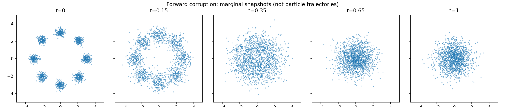
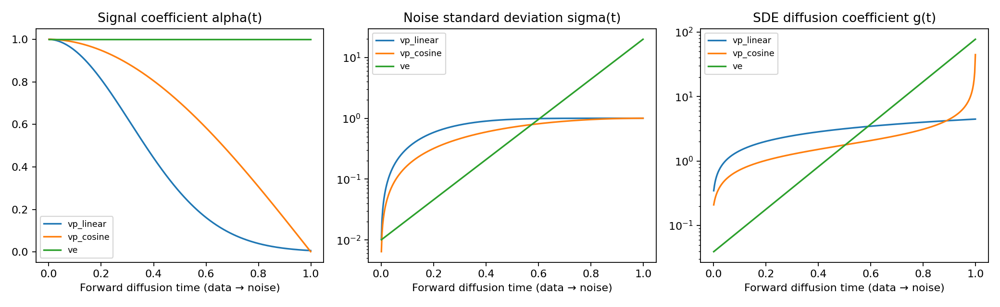
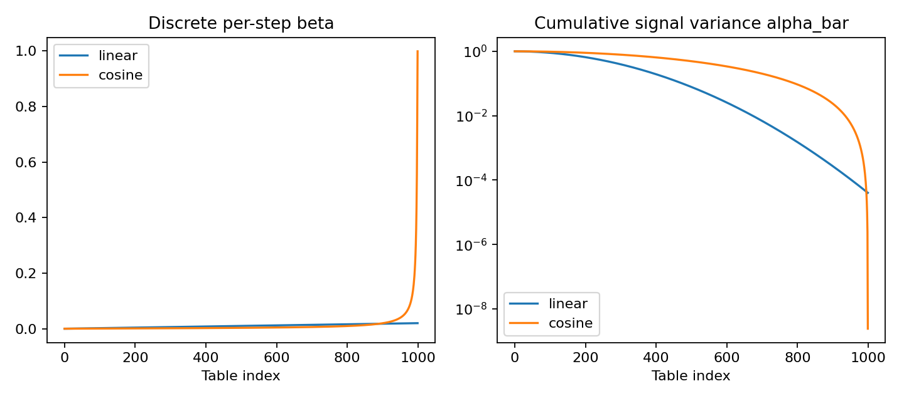

# 2. Diffusion: corruption, prediction, and generation

## A tractable corruption kernel

Start with clean data X₀ and independent Z∼N(0,I):

$$X_t=\alpha_t X_0+\sigma_t Z,\qquad
p_t(x\mid x_0)=\mathcal N(x;\alpha_t x_0,\sigma_t^2I).$$

α scales signal and σ scales noise. Training can draw a state at an arbitrary
time directly, without simulating all previous steps. This formula specifies
marginals and a conditional kernel; using one fixed Z for every t does not
automatically produce the trajectories of the forward SDE.

Each panel is a marginal snapshot. VP eventually suppresses the signal and
produces approximately standard Gaussian noise.

## Variance-preserving SDE

Choose f(x,t)=−β(t)x/2 and g(t)=√β(t):

$$dX_t=-\tfrac12\beta(t)X_t\,dt+\sqrt{\beta(t)}\,dW_t.$$

Let B(t)=∫₀ᵗ β(u)du. Solving the linear SDE gives

$$\alpha_t=e^{-B(t)/2},\qquad \sigma_t^2=1-e^{-B(t)}.$$

The name variance-preserving means a standard normal starting distribution stays
standard normal. It does not mean every dataset has constant variance:

$$\operatorname{Var}(X_t)=\alpha_t^2\operatorname{Var}(X_0)+\sigma_t^2 I.$$

For linear β(t)=β_min+(β_max−β_min)t:

$$B(t)=\beta_{\min}t+\tfrac12(\beta_{\max}-\beta_{\min})t^2.$$

For the cosine path, with c=0.008:

$$
\alpha_t=\frac{\cos(\frac{\pi}{2}\frac{t+c}{1+c})}
{\cos(\frac{\pi}{2}\frac{c}{1+c})},\qquad
\beta(t)=-2\frac{d}{dt}\log\alpha_t
=\frac{\pi}{1+c}\tan\left(\frac{\pi}{2}\frac{t+c}{1+c}\right).
$$

Cosine β diverges at t=1. Continuous integration stops short of that endpoint.
The discrete cosine schedule separately caps each beta below one.

## Variance-exploding SDE

Choose zero drift and a growing noise scale:

$$dX_t=\sqrt{\frac{d\sigma(t)^2}{dt}}\,dW_t,\qquad
\sigma(t)=\sigma_{\min}(\sigma_{\max}/\sigma_{\min})^t.$$

Thus α=1 and

$$g(t)=\sigma(t)\sqrt{2\log(\sigma_{\max}/\sigma_{\min})}.$$

This conventional VE parameterization starts at a slightly smoothed data
distribution p₀∗N(0,σ_min²I), rather than mathematically noiseless data.
Starting with that smoothed distribution makes its SDE marginals agree exactly
with X_t=X₀+σ(t)Z. The finite terminal distribution is approximated by
N(0,σ_max²I); the data contribution is small, but not identically absent.

In VE, the signal persists while noise grows. In VP, signal disappears and noise
approaches unit scale. Neither family is simply a different DDPM beta table.

## What should a network predict?

The network sees x,t, and optionally a class label. We can train several targets:

| Name | Per-example target | Least-squares optimum |
|---|---|---|
| epsilon | Z | E[Z∣X_t=x] |
| x0 | X₀ | E[X₀∣X_t=x] |
| score | −Z/σ_t | ∇log p_t(x) |
| v | α_t Z−σ_t X₀ | E[α_t Z−σ_t X₀∣X_t=x] |

Why does regression give these optima? For target Y and input X, expand the
conditional squared error around m(X)=E[Y∣X]. The cross term is zero:

$$
\mathbb E[\|h(X)-Y\|^2]
=\mathbb E[\|h(X)-m(X)\|^2]
+\mathbb E[\|m(X)-Y\|^2].
$$

The irreducible second term explains a nonzero converged loss.

For Gaussian corruption the conditional score is

$$\nabla_x\log p_t(x\mid X_0)=-\frac{x-\alpha_tX_0}{\sigma_t^2}=-Z/\sigma_t.$$

Differentiate p_t(x)=∫p_t(x∣x₀)p₀(x₀)dx₀ and divide by p_t(x).
This shows the marginal score equals the conditional expectation of the
conditional score. Score regression is therefore valid without knowing p_t.

Code: [training_target](../diffusion_lab/targets.py) and
[perturb](../diffusion_lab/train.py).

## Tweedie and equivalent predictions

The preceding identity gives

$$s_t(x)=-\frac{x-\alpha_t\mathbb E[X_0\mid X_t=x]}{\sigma_t^2}.$$

Rearrange:

$$
\hat x_0=\frac{x+\sigma_t^2\hat s_t}{\alpha_t},\qquad
\hat\epsilon=-\sigma_t\hat s_t,\qquad
\hat x_0=\frac{x-\sigma_t\hat\epsilon}{\alpha_t}.
$$

This scaled Gaussian version of Tweedie's formula requires α≠0 and Gaussian
corruption. It estimates a posterior mean, not the particular clean observation
that generated the noisy sample.

For v=αε−σx₀, solve the two linear equations:

$$
\hat x_0=\frac{\alpha x-\sigma\hat v}{\alpha^2+\sigma^2},\qquad
\hat\epsilon=\frac{\sigma x+\alpha\hat v}{\alpha^2+\sigma^2}.
$$

The denominator is one for VP. The implementation retains it, allowing the
algebra to be checked for other Gaussian paths. Calling this generalized VE
target v is an algebraic option, rather than a standard recommended VE objective.

Code: [convert_prediction](../diffusion_lab/targets.py). Round-trip tests start
with known x₀,Z, construct x, and recover the original quantities for every target.

Equivalent exact functions do not imply equivalent optimization. Time weighting,
target scale, and finite network capacity change training behavior. This lab uses
plain mean squared error for epsilon/x0/v. Score loss is multiplied by σ², yielding
a stable denoising score-matching objective. It does not reproduce each paper's
full variational bound or all recommended loss weighting schemes.

## Reverse-time SDE and probability-flow ODE

For scalar state-independent g, the reverse-time SDE is

$$dX_t=[f(X_t,t)-g(t)^2s_t(X_t)]\,dt+g(t)\,d\overline W_t,
\qquad t:1\rightarrow0.$$

Here dt is negative and the reverse Brownian increment has covariance |dt|I.
Do not change the drift sign a second time when using a negative integration step.
Equivalently, on an increasing reverse clock r=1−t the drift becomes
−f(x,1−r)+g(1−r)²s_{1−r}(x).

The probability-flow ODE is

$$\frac{dX_t}{dt}=f(X_t,t)-\tfrac12g(t)^2s_t(X_t),\qquad t:1\rightarrow0.$$

The factor is one for the reverse SDE and one-half for the ODE. An approximate
score, finite terminal prior, truncated endpoints, and numerical error can make
their generated marginals differ.

Code: continuous branches of [sample](../diffusion_lab/sampling.py).

## DDPM: discrete VP

Use steps n=1,…,T:

$$q(x_n\mid x_{n-1})=\mathcal N(\sqrt{1-\beta_n}x_{n-1},\beta_nI).$$

Define a_n=1−β_n and A_n=∏_{j≤n}a_j, with A₀=1. Then

$$x_n=\sqrt{A_n}x_0+\sqrt{1-A_n}Z.$$

The code table starts at index zero for mathematical step one. Clean data is a
separate endpoint with index −1. Training t=(index+1)/T matches that table.

Bayes' rule for the two Gaussian kernels gives the posterior:

$$
q(x_{n-1}\mid x_n,x_0)=\mathcal N(\tilde\mu_n,\tilde\beta_nI),
\quad
\tilde\beta_n=\beta_n\frac{1-A_{n-1}}{1-A_n},
$$

$$
\tilde\mu_n=
\frac{\sqrt{A_{n-1}}\beta_n}{1-A_n}x_0+
\frac{\sqrt{a_n}(1-A_{n-1})}{1-A_n}x_n.
$$

Replace x₀ with its learned estimate and draw the reverse sample. At the final
clean endpoint, posterior variance is zero. The implementation uses this fixed
posterior variance; it does not learn variance.

For a skipped step n→m, replace a_n with A_n/A_m and β_n with 1−A_n/A_m.
This is a respaced ancestral sampler, not the original full T-step chain.

The linear schedule scales endpoints 10⁻⁴ and 0.02 by 1000/T. Very short tables
can produce invalid betas and are rejected. Cosine tables discretize the
continuous cumulative cosine signal and cap beta at 0.999.

## DDIM: another reverse construction

Given step n and earlier step m, estimate clean x₀ and noise ε. Define

$$
\sigma_{n\rightarrow m}
=\eta\sqrt{\frac{1-A_m}{1-A_n}\left(1-\frac{A_n}{A_m}\right)}.
$$

Then

$$
x_m=\sqrt{A_m}\hat x_0
+\sqrt{1-A_m-\sigma_{n\rightarrow m}^2}\hat\epsilon
+\sigma_{n\rightarrow m}Z'.
$$

η=0 is deterministic given initial noise. η=1 recovers the corresponding
posterior-variance ancestral update. At the clean endpoint A_m=1, the update
returns the clean estimate without adding noise.

DDIM is related to deterministic diffusion ODE sampling, but a DDIM step is
not generically an Euler step in the original VP coordinates. Both use the
learned corruption model, with different integration/update constructions.

## Run and inspect

~~~bash
python -m diffusion_lab.train process.prediction=x0 \
  run_dir=outputs/gmm_ddpm_x0
python -m diffusion_lab.evaluate \
  --checkpoint outputs/gmm_ddpm_x0/checkpoint.pt \
  --output outputs/ddpm_example --method ddpm --steps 1000
python -m diffusion_lab.evaluate \
  --checkpoint outputs/gmm_ddpm_x0/checkpoint.pt \
  --output outputs/ddim_example --method ddim --steps 20
python -m diffusion_lab.train experiment=gmm_vp
python -m diffusion_lab.train experiment=gmm_ve
~~~

Compare samples and runtime with identical initial seeds. Look for mode loss,
overly broad components, and solver effects; target regression loss alone is
not a generation-quality metric.

**Exercise:** train all four targets with the same VP process. Convert each output
to a score before comparing error against the analytic score. Do not compare
their raw training-loss values as though they measured the same quantity.

Primary sources: [DDPM](https://arxiv.org/abs/2006.11239),
[DDIM](https://arxiv.org/abs/2010.02502),
[improved diffusion/cosine schedules](https://arxiv.org/abs/2102.09672),
[score SDEs](https://arxiv.org/abs/2011.13456),
[diffusion v and distillation](https://arxiv.org/abs/2202.00512).

**Next:** [flow matching and transport](03_flows_and_transport.md).
