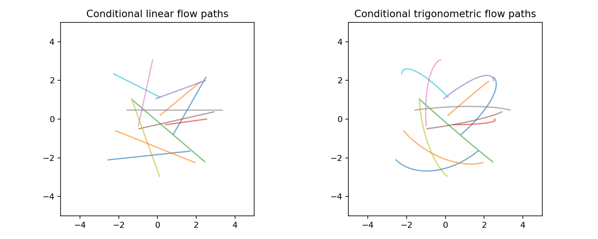
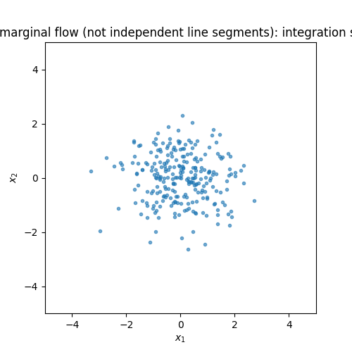
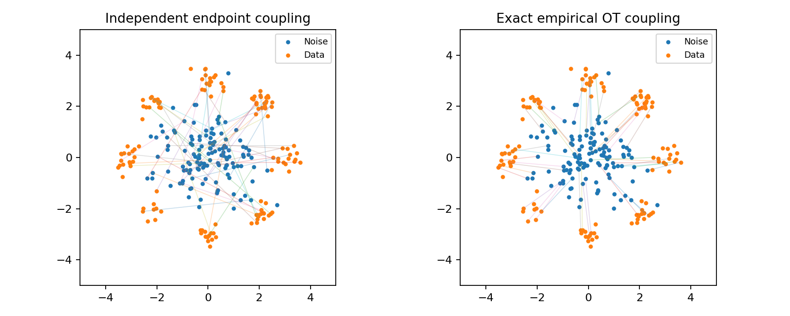

# 3. Flow matching, rectification, and optimal transport

## Construct a path we can supervise

Use increasing generation time r, a source Z, and a target Y. Draw endpoint pairs
from a coupling π(z,y). Independent Gaussian noise and data are the simplest
coupling, but not the only possibility.

For a Gaussian interpolation:

$$X_r=a(r)Y+s(r)Z,\qquad U_r=a'(r)Y+s'(r)Z.$$

U is the velocity of this particular endpoint-conditioned path. It is directly
available from sampled endpoints, so training need not simulate a learned ODE.

Two implemented choices:

| Path | a(r) | s(r) | Conditional velocity |
|---|---|---|---|
| Linear | r | 1−r | Y−Z |
| Trigonometric | sin(πr/2) | cos(πr/2) | (π/2)[cos(πr/2)Y−sin(πr/2)Z] |

[flow_coefficients](../diffusion_lab/paths.py) exposes the coefficients and their
derivatives. [perturb](../diffusion_lab/train.py) forms the state and target.

These curves use known endpoint pairs. They visualize the supervision path,
rather than trajectories of a learned model.

## From conditional velocity to one marginal field

Train

$$\mathcal L_{\rm FM}
=\mathbb E_{r,(Z,Y)\sim\pi}\|v_\theta(X_r,r)-U_r\|^2.$$

The regression optimum is v*(x,r)=E[U_r∣X_r=x]. Why does that field transport
the desired marginal p_r? For a smooth test function φ:

$$
\frac{d}{dr}\mathbb E[\phi(X_r)]
=\mathbb E[\nabla\phi(X_r)\cdot U_r]
=\mathbb E[\nabla\phi(X_r)\cdot v^*(X_r,r)].
$$

Integration by parts yields the continuity equation
∂_r p_r=−∇·(p_r v*). Thus the conditional construction supplies a tractable
training target for a marginal transport field.

Generate a new sample by drawing an initial source state and solving

$$dX_r/dr=v_\theta(X_r,r),\qquad r:0\rightarrow1.$$

The model never sees a target endpoint at generation time.

This analytic GMM example uses conditional expectations computed from a known
density. Particles follow its marginal velocity. Compare it with
[straight conditional interpolation](../assets/teaching/gaussian_diffusion/flow_linear_conditional.gif):
averaging intersecting lines can produce curved ODE trajectories.

## Flow matching and diffusion

Both approaches learn a vector-valued, time-conditioned function and can generate
through an ODE. They differ in what is supervised and how the marginal path is
chosen. Diffusion typically trains a score/noise/denoiser for a corruption process.
Flow matching trains the velocity of a chosen probability path.

For a Gaussian diffusion marginal X_t=α_tY+σ_tZ, its deterministic marginal
velocity in increasing corruption time is

$$
v_t(x)=\alpha_t' \mathbb E[Y\mid x]
+\sigma_t'\mathbb E[Z\mid x].
$$

For α'=(f coefficient)α and (σ²)'=2(f coefficient)σ²+g², substituting the
score/Tweedie identities gives f−g²s_t/2. Therefore diffusion paths can also be
used for flow-matching supervision. Reversing the time clock changes the velocity
sign. The trigonometric flow path in this code is a separate explicit path,
not the discrete cosine DDPM table.

Diffusion v=αZ−σY is a prediction target. Flow velocity is a time derivative.
Their coefficients and units generally differ; do not substitute one for the
other without deriving the clock and scaling.

## Rectified flow

Linear conditional paths give

$$X_r=(1-r)Z+rY,\qquad \mathcal L=\mathbb E\|v_\theta(X_r,r)-(Y-Z)\|^2.$$

This is the basic rectified-flow regression construction. Its learned ODE maps
the source into a target marginal, creating a new endpoint coupling. Under
ideal assumptions, rectification has useful convex transport-cost properties.
Finite-capacity models, numerical integration, and empirical datasets introduce
error; the code does not assume those properties automatically hold.

## Reflow

Draw Z, run a trained teacher to obtain Y_teacher=T_teacher(Z), and keep these
paired endpoints. Train a new linear flow on these pairs. This replaces the
original independent coupling with the teacher's induced coupling.

The teacher's target distribution is reproduced approximately, so reflow can
inherit its errors. Lower trajectory curvature and better coarse-step sampling
are goals to measure, not guarantees for every run. Straightening is also not
a proof of global optimal transport.

~~~bash
python -m diffusion_lab.train experiment=gmm_flow run_dir=outputs/gmm_flow
python -m diffusion_lab.train experiment=gmm_reflow \
  reflow_checkpoint=outputs/gmm_flow/checkpoint.pt
~~~

The current replay example is unconditional and two-dimensional. Its endpoint
pool is finite; the dataset GMM remains an independent evaluation reference.

## What is a coupling?

For conditional flow training, a coupling must preserve the source marginal
**within each class**. Globally assigning Gaussian noise to labeled data can
send positive noise mostly to one class and negative noise to another. Starting
each conditional sampler from the full Gaussian would then use the wrong prior.
The conditional trainer therefore solves assignment separately within the
original data classes, before classifier-free label dropout. Each class retains
its original independent Gaussian noise samples; unconditional training uses
global minibatch assignment.

A coupling is a joint distribution whose two marginals equal the source and
target distributions. Independent pairing, assignment pairing, and the
teacher's endpoint pairing have different transport costs even with the same
individual endpoint distributions.

For squared Euclidean cost c(z,y)=‖z−y‖²/2, optimal transport solves

$$\inf_{\pi\in\Pi(p_{\rm source},p_{\rm target})}\mathbb E_\pi[c(Z,Y)].$$

For equal-size, equally weighted empirical samples, a minimum-cost assignment
solves the discrete problem exactly. [exact_pairing](../diffusion_lab/transport.py)
uses the Hungarian algorithm. It preserves the endpoint marginals by reordering
samples, not deleting difficult samples.

The right pairing reduces empirical squared displacement. This is batch-level OT.
It does not establish that a neural generator learns population OT.

In a conditional training batch, the code reorders source noise instead of
data; class labels remain attached to their target observations.

## Dynamic OT intuition

The quadratic Wasserstein problem also has a dynamic formulation: minimize
∫₀¹∫‖v_r(x)‖²p_r(x)dxdr under the continuity equation and fixed endpoint
marginals (up to a conventional factor of one-half in the cost).
Particles in an optimal displacement interpolation travel along straight paths
under suitable assumptions on the measures.

Independent endpoint straight lines are usually not the globally optimal
coupling. Conditional straightness, marginal flow straightness, and OT
optimality are three different statements.

## Experiments

~~~bash
python -m diffusion_lab.train experiment=gmm_flow \
  process.coupling=independent run_dir=outputs/flow_independent
python -m diffusion_lab.train experiment=gmm_flow \
  process.coupling=ot batch_size=128 run_dir=outputs/flow_ot
python -m diffusion_lab.train experiment=gmm_flow \
  process.flow_path=trigonometric run_dir=outputs/flow_trigonometric
python scripts/run_comparisons.py --device cpu
~~~

Inspect sample metrics, coarse-step error, runtime, and the
[empirical coupling-cost report](../assets/teaching/gaussian_diffusion/ot_costs.json). Exact OT can
reduce target variability within a batch, but its CPU assignment cost also
increases training overhead.

**Exercise:** compare Euler with 5, 10, and 50 steps for independent flow, OT flow,
and reflow using the same initial noise. Compute both endpoint quality and excess
trajectory length. A good endpoint metric alone does not establish straightness.

Sources: [flow matching](https://arxiv.org/abs/2210.02747),
[rectified flow](https://arxiv.org/abs/2209.03003),
[conditional flow matching/OT connections](https://arxiv.org/abs/2302.00482).

**Next:** [conditional generation and guidance](04_guidance.md).
