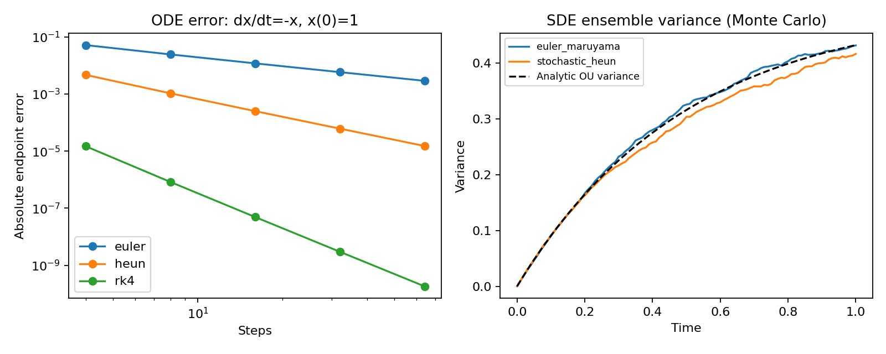

# 5. Numerical ODE and SDE methods

A learned field does not specify a discrete sampler by itself. We must approximate
its continuous dynamics. Solver error and model error are different.

## Euler

For dx/dt=v(x,t), with step h:

$$x_{n+1}=x_n+h\,v(x_n,t_n).$$

Euler uses one field evaluation per step and has global error O(h) for sufficiently
smooth, stable problems. Decreasing the number of steps can make curves visibly
different from the intended flow.

## Heun (explicit trapezoid)

Predict with Euler, evaluate at the predicted endpoint, and average:

$$k_1=v(x_n,t_n),\quad \tilde x=x_n+hk_1,\quad
x_{n+1}=x_n+\tfrac h2[k_1+v(\tilde x,t_n+h)].$$

Two field evaluations give second-order global accuracy under standard smoothness
assumptions. A neural field near singular endpoints may not satisfy those
assumptions uniformly.

## Classical RK4

$$
k_1=v(x,t),\quad
k_2=v(x+\tfrac h2k_1,t+\tfrac h2),\quad
k_3=v(x+\tfrac h2k_2,t+\tfrac h2),\quad
k_4=v(x+hk_3,t+h),
$$

$$x_{\rm next}=x+\tfrac h6(k_1+2k_2+2k_3+k_4).$$

Four evaluations give fourth-order accuracy for smooth fields. Compare methods
at matched network evaluations: 25 RK4 steps cost roughly as many field calls as
100 Euler steps. CFG can multiply the number of network calls per field call.

## Adaptive RK45

The implementation also wraps SciPy's Dormand–Prince RK45. An embedded error
estimate changes the internal step size to meet relative and absolute
tolerances. Output frames are interpolated at the requested times.

This educational wrapper transfers field evaluations between NumPy and PyTorch,
so it is useful for small GMM examples but inefficient for large GPU image
batches. It is not a differentiable adjoint solver.

## Euler–Maruyama: Itô SDE

For dx=b(x,t)dt+g(t)dW:

$$x_{\rm next}=x+h\,b(x,t)+g(t)\sqrt{|h|}Z,\qquad Z\sim\mathcal N(0,I).$$

Negative h is valid when b is the reverse-time diffusion drift. The Brownian
variance is |h|. Do not use ordinary Euler without noise and call it an SDE sampler.

For general SDEs, Euler–Maruyama has strong order one-half and weak order one under
appropriate conditions. Additive-noise cases can have better strong behavior.
Strong error concerns individual trajectories under matched Brownian paths;
weak error concerns expectations of functions of the state.

## Stochastic Heun

Predict using drift and one Brownian increment, then average drift evaluations
and the time-dependent diffusion coefficients using the same increment.
Our implementation restricts g to be independent of x. In that setting the
Itô/Stratonovich correction is zero.

For multiplicative noise, an unmodified stochastic Heun scheme generally has
different interpretation. The solver is not advertised for that case.

## Langevin predictor–corrector

At a fixed noise time, Langevin correction approximately explores its density:

$$x\leftarrow x+\delta\,s_t(x)+\sqrt{2\delta}\,Z.$$

Follow corrections with a reverse-SDE predictor step. The code sets δ from a
user-selected signal-to-noise ratio and ensemble score/noise norms. Finite
corrections are neither exact equilibrium sampling nor an automatic improvement.
An inaccurate score can cause divergence.

~~~bash
python -m diffusion_lab.train experiment=gmm_ve sampler=pc \
  run_dir=outputs/ve_predictor_corrector
~~~

## Diffusion-specific updates

DDPM and DDIM exploit known Gaussian coefficients rather than treating every
reverse process as a generic black-box field. Deterministic DDIM can be understood
through an exponential-integrator view after changing coordinates. Dedicated
DPM-Solver/DPM-Solver++ first-order and second-order multistep variants are
implemented in [dpm_solver.py](../diffusion_lab/dpm_solver.py). See
[advanced diffusion](09_advanced_diffusion.md) for their log-SNR coordinates,
final denoising call, and measured network-evaluation costs.

## Accuracy lesson

Left: integrate dx/dt=−x, x(0)=1 and compare with e⁻¹. The slopes show the expected
deterministic orders. Right: simulate dX=−Xdt+dW from zero. Its analytic variance
is (1−e⁻²ᵗ)/2. Monte Carlo variance fluctuates, even for a good integrator.

Code: [ode_step, sde_step, integrate](../diffusion_lab/solvers.py).

~~~bash
python -m diffusion_lab.lessons
python -m diffusion_lab.evaluate \
  --checkpoint outputs/gmm_flow/checkpoint.pt \
  --output outputs/flow_rk4 --solver rk4 --steps 10
python -m diffusion_lab.evaluate \
  --checkpoint outputs/gmm_flow/checkpoint.pt \
  --output outputs/flow_adaptive --solver rk45 --steps 40 --samples 128
~~~

The requested adaptive output count is not the number of internal RK45 steps.

**Exercise:** compare Euler/Heun/RK4 at approximately matched field evaluations.
Then hold the solver fixed and change the trained checkpoint. Separate numerical
error from learned-field error. For stochastic convergence experiments, match
coarse Brownian increments to sums of fine increments.

Sources: [score-SDE predictor–corrector](https://arxiv.org/abs/2011.13456),
[SciPy RK45 documentation](https://docs.scipy.org/doc/scipy/reference/generated/scipy.integrate.RK45.html),
[DPM-Solver](https://arxiv.org/abs/2206.00927),
[DPM-Solver++](https://arxiv.org/abs/2211.01095).

**Next:** [Schrödinger bridges and matching](06_bridges.md).
