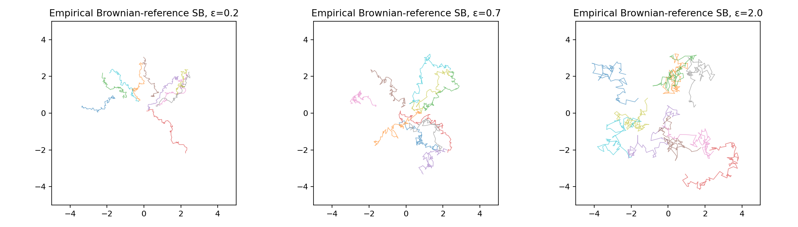
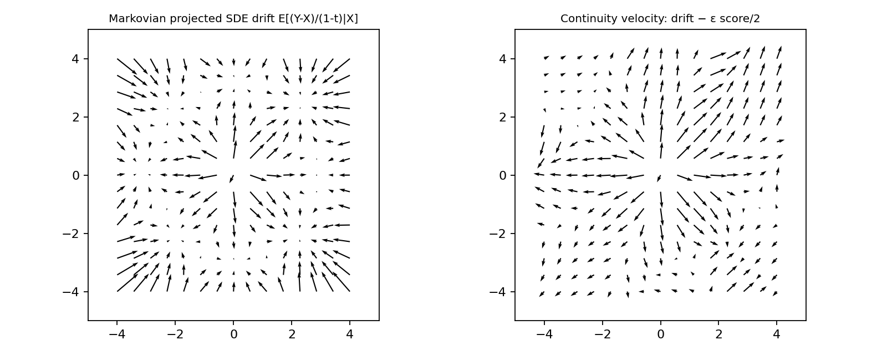

# 6. Entropic transport, Schrödinger bridges, and bridge matching

## Two fixed endpoint distributions

Diffusion often chooses a convenient noise endpoint. A bridge problem specifies
both source and target distributions. We seek dynamics joining them, with a
criterion deciding which of the many possible dynamics is preferred.

For quadratic optimal transport, minimize displacement cost over couplings.
For a Schrödinger bridge, minimize relative entropy of a path law against a
reference stochastic process:

$$\min_{P:\,P_0=\mu,\,P_1=\nu}\operatorname{KL}(P\|R).$$

Relative entropy measures how much the chosen process changes the reference.
It is not the entropy of endpoint images or a diversity score.

Use a Brownian reference dX_r=√ε_B dW_r, with positive Brownian variance ε_B.
Here ε_B is a scalar diffusion parameter, distinct from Gaussian noise vectors.

## From a path problem to endpoint entropic OT

Relative entropy decomposes into endpoint-law divergence plus expected
conditional-path divergence. For a fixed endpoint coupling, the optimal
conditional trajectories are the reference's conditional Brownian bridges.
The remaining problem determines the coupling.

The unit-time Brownian transition kernel is proportional to

$$K(z,y)=\exp[-\|z-y\|^2/(2\varepsilon_B)].$$

For equally weighted finite supports with masses a,b, solve

$$
\min_{\pi\mathbf1=a,\ \pi^\top\mathbf1=b}
\langle \pi,C\rangle+\varepsilon_B
\operatorname{KL}(\pi\|a\otimes b),
\qquad C_{ij}=\tfrac12\|z_i-y_j\|^2.
$$

Multiplying the endpoint KL objective by ε_B yields this cost-plus-entropy
formulation up to fixed-marginal constants. This is the Brownian-reference
connection, rather than a claim that every entropic OT cost is the same bridge.

**Finite-support qualification:** this code discretizes the endpoint reference
using the Brownian transition kernel. A literally atomic terminal distribution
is singular to an unrestricted Brownian path law, so its path KL against that
unrestricted law is infinite. The empirical construction is an exact solution
of the finite endpoint problem (up to Sinkhorn tolerance), followed by reference
conditional bridge paths. Interpret it as a discretized approximation of the
continuous Schrödinger problem, not an exception to that absolute-continuity
requirement.

Smaller ε_B places greater emphasis on short displacement and produces less
stochastic path spread. In suitable continuous limits, Schrödinger bridges
approach OT as reference noise vanishes. Finite supports, discretization, and
degenerate limits need their own qualifications.

## Log-domain Sinkhorn

An optimal coupling has a diagonally scaled kernel. Rather than multiplying
tiny numbers, maintain log scalings u,v:

$$
u_i=\log a_i-\operatorname{logsumexp}_j(\log K_{ij}+v_j),\quad
v_j=\log b_j-\operatorname{logsumexp}_i(\log K_{ij}+u_i).
$$

Recover π_ij=exp(log K_ij+u_i+v_j). Check both marginal sums. The implementation
raises an error when the requested convergence tolerance is not achieved.

Code: [sinkhorn_plan](../diffusion_lab/transport.py). It uses double precision
internally and is designed for small educational empirical problems.

## A Brownian bridge conditioned on endpoints

For endpoints z,y and 0<r<1:

$$X_r\mid z,y\sim
\mathcal N((1-r)z+ry,\varepsilon_B r(1-r)I).$$

A sample path with the correct joint law is

$$X_r=(1-r)z+ry+\sqrt{\varepsilon_B}(W_r-rW_1).$$

For r≤s, its conditional covariance is
ε_B(r−rs)I. Independently drawing a Gaussian at each snapshot produces the
correct one-time marginals but the wrong trajectory covariance.

[brownian_bridge_trajectory](../diffusion_lab/bridges.py) constructs Brownian
increments on the whole time grid before subtracting rW₁. Tests verify endpoints,
variance, and cross-time covariance.

Read both effects of changing ε_B: endpoint pairings can change and stochastic
excursions increase. A paired particle still lands on its chosen endpoint.
The [animated version](../assets/teaching/gaussian_diffusion/brownian_bridge_0.7.gif) shows the joint
conditional trajectories.

## Bridge matching: learn a marginal drift

A conditioned Brownian bridge has forward drift

$$b_r^{z,y}(x)=\frac{y-x}{1-r}.$$

Sample an endpoint pair from the Sinkhorn coupling, sample X_r from its bridge,
and regress this drift. The least-squares optimum is

$$b_r(x)=\mathbb E[(Y-X_r)/(1-r)\mid X_r=x].$$

This is a Markovian projection: the field depends on current state and time,
rather than retaining a particular endpoint label throughout the trajectory.
Under the appropriate regularity assumptions, its SDE has the same one-time
marginals as the endpoint-conditioned bridge mixture.

For the optimal Brownian-reference endpoint coupling, this connects to the
empirical Schrödinger bridge. For an arbitrary coupling, matching its mixture
does not automatically solve the Schrödinger optimization problem.

Train and sample:

~~~bash
python -m diffusion_lab.train experiment=gmm_bridge \
  run_dir=outputs/gmm_bridge_sde
~~~

The learned model is a drift, not a diffusion score. Sampling uses increasing
bridge time with constant diffusion √ε_B.

## An ODE for the same bridge marginals

The conditional bridge score is

$$s_r^{z,y}(x)=-\frac{x-[(1-r)z+ry]}{\varepsilon_B r(1-r)}.$$

Subtract half the diffusion variance times score from the drift:

$$
u_r^{z,y}(x)=b_r^{z,y}(x)-\tfrac12\varepsilon_B s_r^{z,y}(x)
=y-z+\frac{1-2r}{2r(1-r)}[x-(1-r)z-ry].
$$

Regressing this conditional continuity velocity gives the marginal ODE field.
The training implementation equivalently differentiates the Gaussian path's
standard deviation. Drift and velocity are separate targets.

~~~bash
python -m diffusion_lab.train experiment=gmm_bridge \
  process.prediction=velocity sampler=ode \
  run_dir=outputs/gmm_bridge_ode
~~~

The analytic fields average over all endpoint pairs using their state-dependent
posterior weights. The left field belongs to an SDE; the right belongs to an ODE.
Their difference is ε_B times the marginal score divided by two.

## Endpoints and implementation limits

Finite-support Brownian bridges have singular endpoint drifts. Learned matching
uses r in [δ,1−δ], with δ=0.02 by default. Evaluation initializes at the **correct
bridge marginal at δ**, sampled from the same coupling, rather than pretending
that a discrete source distribution is already that marginal. The last learned
sample is at 1−δ, so comparison with the true target includes endpoint truncation
error.

The exact conditional-path lesson reaches both endpoints. Neural matching
approximates its continuous-time marginal field on the interior. This distinction
is deliberate and recorded in the experiment configuration.

## Iterative bridge algorithms

For large continuous datasets, a finite global Sinkhorn table is not scalable.
Iterative proportional fitting alternates endpoint constraints; iterative
Markovian fitting alternates a Markovian projection with a reciprocal projection
using reference bridges. DSBM learns these projections through neural regression.

This chapter's implementation uses a direct finite empirical endpoint solve
followed by learned Markovian matching. The separate
[iterative DSBM chapter](11_iterative_bridges.md) implements alternating neural
forward/backward fitting and endpoint replay, with IMF/IPF initialization.
These demonstrations do not claim an image-scale Schrödinger bridge benchmark.

**Exercise:** use independent coupling in place of the optimal Sinkhorn coupling.
Compare endpoint marginals, transport cost, and drift fields. Then decrease δ
and increase solver steps together: determine which errors arise from truncation,
regression, integration, and finite endpoint samples.

Sources: [Schrödinger problem survey](https://arxiv.org/abs/1308.0215),
[Sinkhorn](https://arxiv.org/abs/1306.0895),
[diffusion Schrödinger bridge matching](https://arxiv.org/abs/2303.16852).

**Next:** [experimental practice and metrics](07_experiments_and_metrics.md).
