# 8. Results from actual runs

These figures and values come from the saved local experiments, not paper
benchmarks. Training used the simple_udm environment on the three L40S GPUs
of chapelle. Configurations and metrics are exported alongside each figure.
The tables below are regenerated from assets/metadata/results.json.

## Learned Gaussian-mixture models

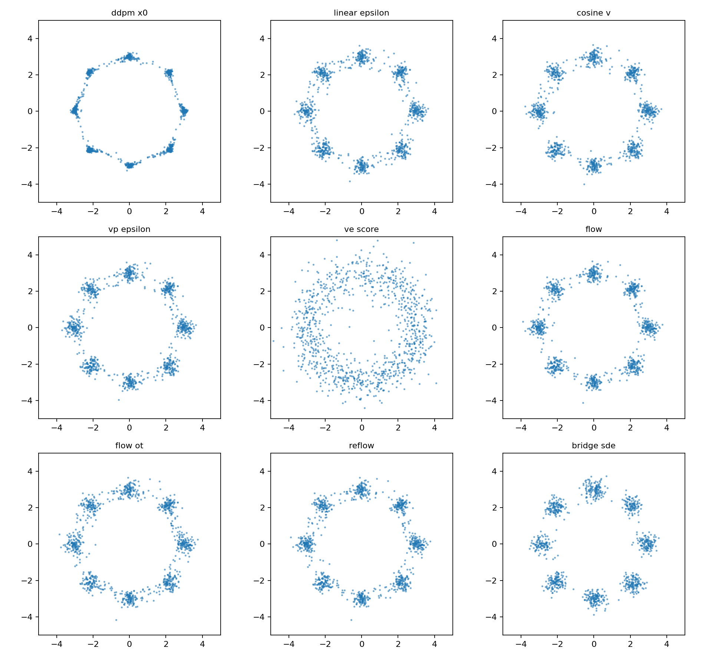

Each panel contains 1,024 generated particles. The target is eight Gaussian
components on a radius-three ring, with component standard deviation 0.25.
Look at cloud width, off-mode samples, and occupancy before reading a score.
Most runs use 6,000 optimizer steps; bridge runs use 8,000.

| Experiment | Sliced W2 | Empirical W2 (512) | Within 3σ | Mode coverage |
|---|---:|---:|---:|---:|
| [gmm_ddpm_x0](../assets/experiments/toy/gmm_ddpm_x0/metrics.json) | 0.2040 | 0.4240 | 0.955 | 1.000 |
| [gmm_linear_epsilon](../assets/experiments/toy/gmm_linear_epsilon/metrics.json) | 0.1545 | 0.3379 | 0.915 | 1.000 |
| [gmm_cosine_v](../assets/experiments/toy/gmm_cosine_v/metrics.json) | 0.1568 | 0.3545 | 0.944 | 1.000 |
| [gmm_vp_epsilon](../assets/experiments/toy/gmm_vp_epsilon/metrics.json) | 0.1582 | 0.3465 | 0.933 | 1.000 |
| [gmm_ve_score](../assets/experiments/toy/gmm_ve_score/metrics.json) | 0.3239 | 0.6701 | 0.423 | 1.000 |
| [gmm_flow](../assets/experiments/toy/gmm_flow/metrics.json) | 0.1639 | 0.3392 | 0.936 | 1.000 |
| [gmm_flow_ot](../assets/experiments/toy/gmm_flow_ot/metrics.json) | 0.1640 | 0.3228 | 0.896 | 1.000 |
| [gmm_reflow](../assets/experiments/toy/gmm_reflow/metrics.json) | 0.1629 | 0.3359 | 0.911 | 1.000 |
| [gmm_bridge_sde](../assets/experiments/bridges/gmm_bridge_sde/metrics.json) | 0.1514 | 0.4820 | 0.965 | 1.000 |

These are single-seed runs with different objectives and some different
sampling grids. Their values do not establish a general ranking of methods.
The real-versus-real diagnostic shows that finite sample measures differ
even when both are drawn from the correct target distribution.

## Conditional generation

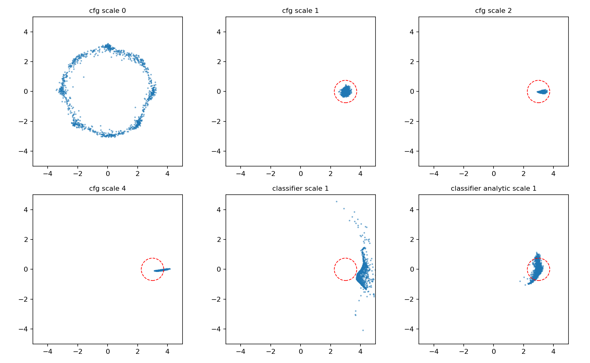

All conditional panels target component zero at (3,0). The red circle is
the 3σ diagnostic region. CFG scale zero generates unconditionally. Strong
CFG changes the cloud's spread and location; bigger scale need not improve
distribution fidelity.

The learned classifier panel is retained even though it distorts the cloud.
The analytic classifier reference isolates the guidance formula from
classifier approximation error. Both still use the learned diffusion model.

| Guidance experiment | Sliced W2 to appropriate reference | Within 3σ |
|---|---:|---:|
| [cfg_scale_0](../assets/experiments/toy/cfg_scale_0/metrics.json) | 0.2534 | 0.796 |
| [cfg_scale_1](../assets/experiments/toy/cfg_scale_1/metrics.json) | 0.1238 | 1.000 |
| [cfg_scale_2](../assets/experiments/toy/cfg_scale_2/metrics.json) | 0.2198 | 1.000 |
| [cfg_scale_4](../assets/experiments/toy/cfg_scale_4/metrics.json) | 0.3708 | 0.930 |
| [classifier_scale_1](../assets/experiments/toy/classifier_scale_1/metrics.json) | 0.8936 | 0.000 |
| [classifier_analytic_scale_1](../assets/experiments/toy/classifier_analytic_scale_1/metrics.json) | 0.1514 | 0.886 |

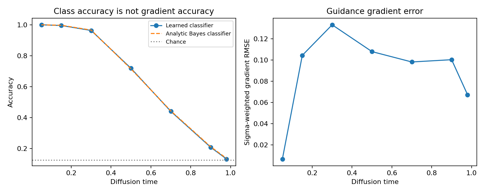

At small noise, the learned classifier has near-perfect classification
accuracy. That alone does not constrain the input gradient sufficiently
for reliable generative guidance. The separate gradient diagnostic compares
it with the known posterior classifier.

## Rectification and reflow

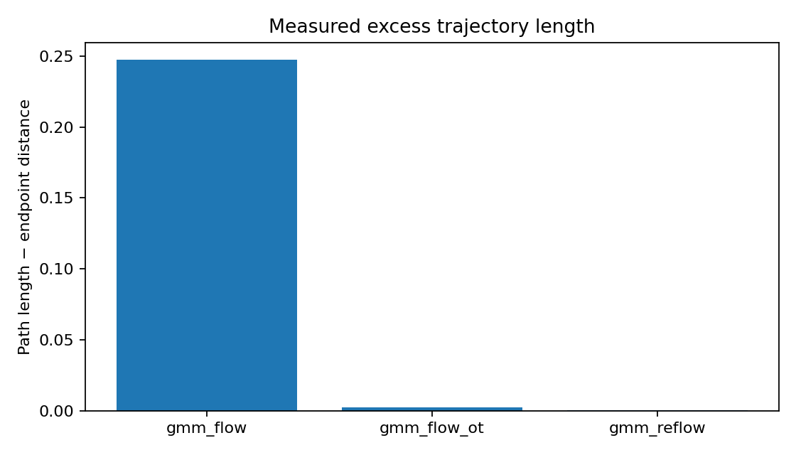

This same-initial-seed measurement compares path length with direct endpoint
distance. Here OT flow and reflow have much smaller excess path length.
This is measured behavior of these checkpoints, not a general OT guarantee.

## Conditional flow generation

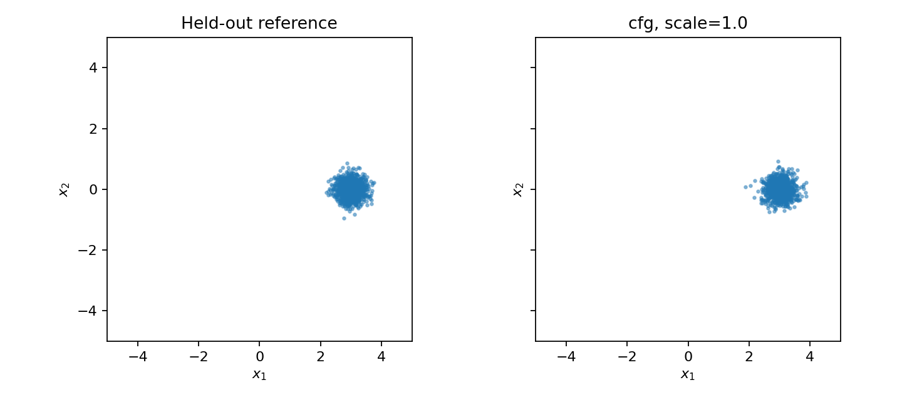

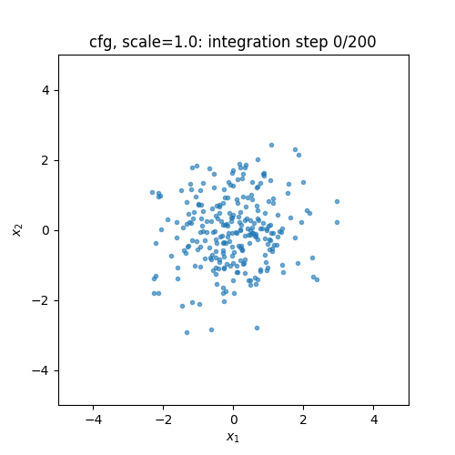

This separately trained flow uses component labels and null-token dropout.
The conditional velocity generates component zero; no diffusion score or
classifier is needed for this ordinary conditional flow example.

## Short image-training baselines

The image experiments resize to 32×32. CelebA/FFHQ use 4,096 training images;
ImageNet uses 10,000, selected across all 1,000 classes. These are deliberately
small teaching runs. ImageNet is trained conditionally with null-token
dropout; the table evaluates its unconditional branch.

| Experiment | Training steps | FID (2048) | KID mean | IS mean | Real/generated count |
|---|---:|---:|---:|---:|---:|
| [celeba_ddpm](../assets/experiments/faces/celeba_ddpm/metrics.json) | 3000 | 250.43 | 0.1904 | 3.065 | 128/128 |
| [celeba_flow](../assets/experiments/faces/celeba_flow/metrics.json) | 3000 | 188.22 | 0.1361 | 2.294 | 128/128 |
| [imagenet_conditional](../assets/experiments/imagenet/imagenet_conditional/metrics.json) | 3000 | 230.36 | 0.0597 | 3.173 | 128/128 |
| [ffhq_ddpm](../assets/experiments/faces/ffhq_ddpm/metrics.json) | 1000 | 398.14 | 0.4427 | 1.795 | 128/128 |

**128-example FID is a noisy diagnostic, not a publishable benchmark.**
Different dataset rows are not directly comparable. IS on face datasets
has limited semantic relevance. Samples remain rough after these short runs.

### CelebA diffusion

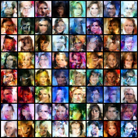

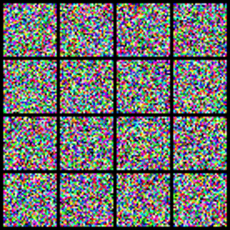

### CelebA flow matching

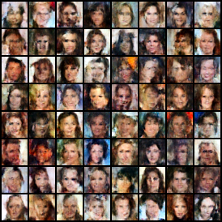

### ImageNet

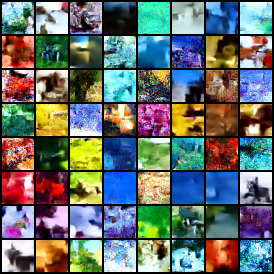

#### Conditional image guidance examples

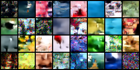

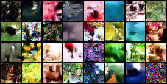

These panels target folder class_0000 using CFG and a separately trained
noisy classifier. The short run does not establish accurate ImageNet class
adherence. Metrics are disabled for these 32-example visual comparisons;
the bounded validation selection has only one reference image per class.

### FFHQ

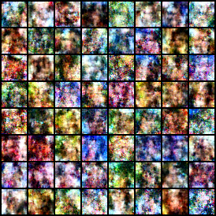

## Sampling budgets

The comparisons below use evaluation seed 123 and the same checkpoint
within each method family. Field evaluations differ between Euler, Heun,
and RK4. CPU/GPU runtime is not mixed into a claim of algorithmic superiority.

| Experiment | Sliced W2 |
|---|---:|
| [gmm_ddpm_ancestral](../assets/experiments/toy/gmm_ddpm_ancestral/metrics.json) | 0.2586 |
| [gmm_ddim_20](../assets/experiments/toy/gmm_ddim_20/metrics.json) | 0.2497 |
| [gmm_ddim_5](../assets/experiments/toy/gmm_ddim_5/metrics.json) | 0.2045 |
| [gmm_flow_euler_10](../assets/experiments/toy/gmm_flow_euler_10/metrics.json) | 0.2478 |
| [gmm_flow_heun_10](../assets/experiments/toy/gmm_flow_heun_10/metrics.json) | 0.2395 |
| [gmm_flow_rk4_10](../assets/experiments/toy/gmm_flow_rk4_10/metrics.json) | 0.2497 |
| [gmm_reflow_euler_10](../assets/experiments/toy/gmm_reflow_euler_10/metrics.json) | 0.2118 |

Coarser steps can coincidentally compensate model error. A lower learned
sample metric at fewer steps does not contradict an integrator's analytic
convergence order. Use the analytic solver lesson to isolate numerical error.

## Reproduce this page

~~~bash
python scripts/export_assets.py
python -m diffusion_lab.diagnostics
python scripts/build_gallery.py
~~~

The exporter keeps checkpoints and raw sample tensors in Git-ignored outputs.
Every exported experiment retains its metrics; training runs also retain
resolved configuration, environment information, and loss history.
