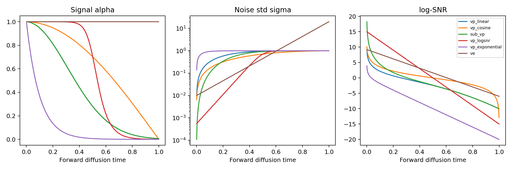
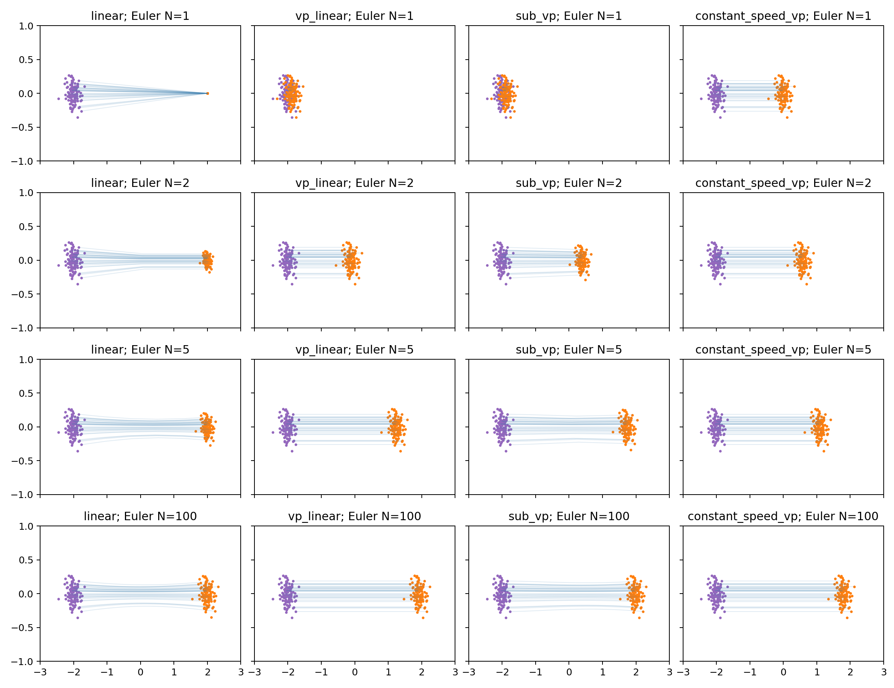
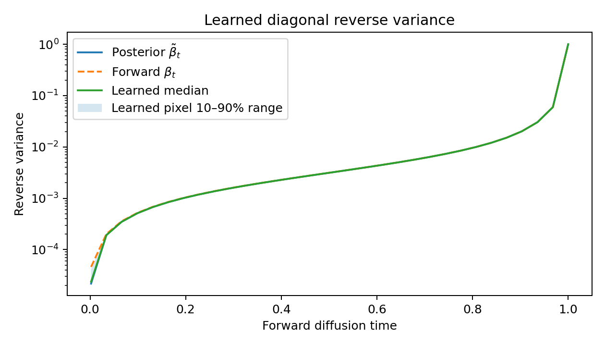
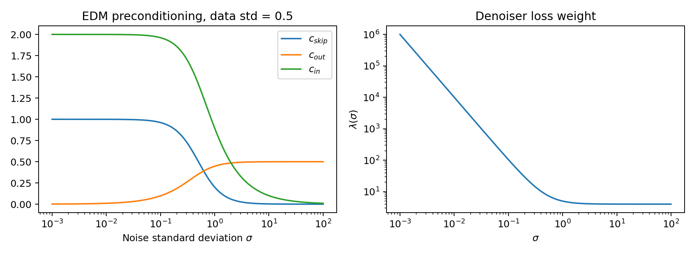

# Advanced diffusion: sub-VP, log-SNR, Improved DDPM and EDM

Read [the diffusion chapter](02_diffusion.md) first. This chapter connects the
additional methods to the same Gaussian corruption law
\(X_t=\alpha(t)X_0+\sigma(t)Z\). A *process* specifies a marginal law and SDE;
a *schedule* specifies how its noise level changes; a *parameterization*
specifies what the network predicts. They can be studied separately.

## Sub-VP

Let \(B(t)=\int_0^t\beta(s)ds\). Ordinary VP uses
\(f(x,t)=-\beta(t)x/2\) and \(g(t)^2=\beta(t)\).
Sub-VP retains this drift but changes its diffusion to

\[
g(t)^2=\beta(t)(1-e^{-2B(t)}).
\]

Its conditional mean is \(e^{-B(t)/2}x_0\), and its conditional **standard
deviation** is \(1-e^{-B(t)}\). Consequently its variance is
\((1-e^{-B(t)})^2\), rather than the ordinary VP variance \(1-e^{-B(t)}\).
Confusing standard deviation and variance changes the entire model.

Check this by differentiating the variance and verifying
\(\dot V=-\beta V+g^2\). The test suite performs this identity with autograd.
The reverse SDE and probability-flow ODE then use these exact coefficients,
as in [GaussianPath](../diffusion_lab/paths.py).

~~~bash
python -m diffusion_lab.train process=subvp sampler=ode run_dir=outputs/gmm_subvp
~~~

The left panel follows labeled particles; the right shows their empirical
histogram. Colors remember the original class even when the distributions overlap.
The histogram is an empirical density visualization, not an exact PDE solution.

## Log-SNR and exponential schedules

Define \(\ell(t)=\log(\alpha(t)^2/\sigma(t)^2)\). For a VP family,

\[
\alpha^2=\operatorname{sigmoid}(\ell),\qquad
\sigma^2=\operatorname{sigmoid}(-\ell).
\]

The linear log-SNR schedule in this toolkit interpolates between finite bounds.
Its SDE coefficient is
\(\beta=-\dot\ell(1-\alpha^2)\). Finite upper log-SNR means the first continuous
marginal already has slight smoothing; it does not have an exactly clean boundary.

The exponential VP schedule uses \(\alpha^2=e^{-\beta t}\), or constant beta.
Conventional VE uses an exponential **noise standard deviation**. These are
different uses of "exponential"; neither should be confused with Karras sampling.
The discrete log-SNR table starts with upper log-SNR 10 to keep its first noise
variance representable in float32; its lower bound is -15.

~~~bash
python -m diffusion_lab.train process=logsnr sampler=ode
python -m diffusion_lab.train process=exponential sampler=ode
python -m diffusion_lab.train process.schedule=logsnr
python -m diffusion_lab.train process.schedule=exponential
~~~

## Improved DDPM: learning diagonal covariance

The DDPM posterior is Gaussian with mean \(\tilde\mu_t(x_t,x_0)\) and variance
\(\tilde\beta_t\). A learned-variance model outputs twice as many channels:
one set predicts epsilon/x0/v/score, and the second predicts variance coordinates.
Here the covariance is **diagonal per pixel**, not a dense covariance matrix.

Given network variance output \(v\), define \(r=(v+1)/2\), then

\[
\log\Sigma_\theta=r\log\beta_t+(1-r)\log\tilde\beta_t.
\]

The published learned-range parameterization does not explicitly clamp v; its
name describes interpolation coordinates rather than a hard mathematical bound.
The first posterior variance is zero. Log calculations use the second posterior
variance at that entry, and generation's last clean step adds no random noise.

The hybrid objective combines regression with a variational term:

\[
L_{\rm hybrid}=L_{\rm simple}+10^{-3}L_{\rm VLB}.
\]

For a uniformly selected timestep, the implementation estimates the timestep
sum by multiplying the selected VLB term by T. Its KLs and the first-step
discretized Gaussian decoder likelihood are in bits per dimension. The terminal
prior KL is constant with respect to model parameters and is omitted from the
training objective; the hybrid loss is **not** a reported full likelihood.
The mean prediction is detached inside the hybrid VLB branch so the variance
term does not change its direct regression gradient. It remains differentiable
for a pure VLB objective. This is tested explicitly.

Code: [improved_ddpm.py](../diffusion_lab/improved_ddpm.py).

~~~bash
python -m diffusion_lab.image_train algorithm=improved_ddpm \
  learned_variance=true model.out_channels=6 objective=hybrid \
  run_dir=outputs/cifar10_improved

# Same machinery, but an unbiased estimator of the VLB timestep sum.
python -m diffusion_lab.image_train algorithm=improved_ddpm \
  learned_variance=true model.out_channels=6 objective=vlb \
  timestep_sampling=loss_second_moment run_dir=outputs/cifar10_vlb
~~~

The adaptive sampler keeps recent losses per timestep, uses probabilities
proportional to their RMS, and includes a uniform probability floor. The factor
\(1/(Tp(t))\) prevents changing the underlying uniformly weighted objective.
Warmup remains uniform until every timestep has enough observations. DDP gathers
observations so all ranks update the same sampler. Its state is checkpointed.
This is importance sampling of **time**, not a new prediction parameterization.

Exercise: compare fixed and learned variance with the same seed, architecture,
training images and compute. Then compare simple/hybrid/VLB training. Changes
in likelihood, regression loss and sample quality need not agree.

## EDM / Karras

EDM works with \(X_\sigma=X_0+\sigma Z\), where sigma is a standard deviation.
The preconditioned denoiser is

\[
D_\theta(x,\sigma)=c_{\rm skip}x+c_{\rm out}
F_\theta(c_{\rm in}x,c_{\rm noise}),
\]

\[
c_{\rm skip}=\frac{\sigma_{\rm data}^2}{\sigma^2+\sigma_{\rm data}^2},\quad
c_{\rm out}=\frac{\sigma\sigma_{\rm data}}{\sqrt{\sigma^2+\sigma_{\rm data}^2}},\quad
c_{\rm in}=\frac1{\sqrt{\sigma^2+\sigma_{\rm data}^2}},\quad
c_{\rm noise}=\tfrac14\log\sigma.
\]

The network F predicts a normalized residual; D predicts clean data. The score
is \((D-x)/\sigma^2\). The noise-level ODE is \(dx/d\sigma=(x-D)/\sigma\).
Training samples \(\log\sigma\sim N(-1.2,1.2^2)\) and weights denoising MSE by
\((\sigma^2+\sigma_{\rm data}^2)/(\sigma\sigma_{\rm data})^2\).
These defaults apply to images scaled to [-1,1], with sigma_data=0.5.

The Karras grid linearly interpolates sigma raised to \(1/\rho\), then raises
back to rho (default 7). It is a **sampling grid**, not a training time distribution.
Heun corrects every step except the last step to sigma=0, where another network
evaluation would be undefined. N levels therefore take 2N-1 denoiser evaluations:
18 levels take 35 evaluations, or 70 with two-pass CFG. Optional churn temporarily
raises sigma and injects Gaussian noise before the deterministic update.

Code: [edm.py](../diffusion_lab/edm.py),
[image_train.py](../diffusion_lab/image_train.py).

~~~bash
python -m diffusion_lab.image_train data=cifar10 algorithm=edm
python -m diffusion_lab.image_evaluate \
  --checkpoint outputs/cifar10_edm_quality/checkpoint.pt \
  --output outputs/cifar10_edm_eval --samples 10000 --steps 18 --scale 1
~~~

The toolkit implements these mathematical components with its own U-Net. It
does not claim to reproduce every architectural or augmentation choice in the
EDM paper, or its published scores.

## Fast solvers and fair cost comparisons

[dpm_solver.py](../diffusion_lab/dpm_solver.py) implements first-order and
second-order multistep DPM-Solver / DPM-Solver++ in
\(\lambda=\log(\alpha/\sigma)=\ell/2\). The former integrates noise predictions;
the latter integrates clean-data predictions. The Gaussian linear term is exact,
while recent network outputs approximate the remaining integral. The first update
has order one; subsequent updates use the prior output and step-size ratio.
Discrete tables are interpolated in log alpha between their nodes.

DDPM with all 1000 steps takes 1000 base predictions. DDIM with 50 steps takes
50. Our DPM comparison with 20 steps plus a final denoising call takes 21.
Heun with N generic ODE steps normally takes 2N. Guidance and classifiers add
work. The evaluator counts actual denoiser calls with a forward hook and records
classifier calls separately; it also records wall time.

~~~bash
python -m diffusion_lab.train sampler=dpmpp
python -m diffusion_lab.image_evaluate \
  --checkpoint outputs/mnist_improved_ddpm/checkpoint.pt \
  --output outputs/mnist_dpm20 --method dpmpp_2m --steps 20 --scale 1
~~~

This analytic translated-Gaussian lesson isolates path geometry. It uses finite
VP endpoints and Euler integration; it does not establish a universal ranking
of methods on trained images. Exercise: replace Euler with Heun and compare
at equal network evaluations.

## Visual checks from trained models

This plot evaluates the trained MNIST variance head on 64 held-out images at
32 noise levels. It compares the predicted pixelwise variance with the two
log-interpolation endpoints. The first posterior point mass is excluded.
The learned-range output is not clamped; the plot is a diagnostic, not a
proof that the covariance is statistically calibrated.

The denoiser weights and network input/output coefficients change together.
The large low-noise denoiser loss weight should be interpreted alongside the
shrinking output coefficient, rather than as an isolated network gradient weight.
Regenerate both figures with `python -m diffusion_lab.quality_lessons`.

Sources: [score SDEs](https://arxiv.org/abs/2011.13456),
[Improved DDPM](https://arxiv.org/abs/2102.09672),
[EDM](https://arxiv.org/abs/2206.00364),
[DPM-Solver](https://arxiv.org/abs/2206.00927),
[DPM-Solver++](https://arxiv.org/abs/2211.01095).
