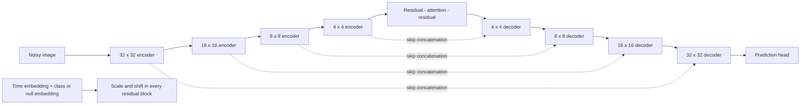

# Image experiments, custom data and reproducibility

The [small training entrypoint](../diffusion_lab/train.py) remains useful for
mathematical GMM lessons. The [image trainer](../diffusion_lab/image_train.py)
supports EDM, Improved DDPM, flow matching, standalone consistency training and
consistency distillation with the larger configurable U-Net.

## Verified benchmarks

CIFAR-10 and MNIST are stored under /data/tii/Image_data/cifar10 and /mnist.
[download_benchmarks.py](../scripts/download_benchmarks.py) uses torchvision's
official archives and checksum checks, exports unresized PNGs by class, then
reopens **every image** and compares its pixels with the original dataset.
Each directory contains verification.json with class counts and ordered hashes.
Copies of the [CIFAR-10 verification](../assets/reports/datasets/cifar10_verification.json)
and [MNIST verification](../assets/reports/datasets/mnist_verification.json) are saved with
the repository, including the index-to-class mapping.

~~~bash
python scripts/download_benchmarks.py --root /data/tii/Image_data
python -m diffusion_lab.image_train data=cifar10
python -m diffusion_lab.image_train data=mnist model.width=32 \
  model.channel_mult='[1,2,2]' model.attention_levels='[2]' steps=20000
~~~

CIFAR-10 has 50,000 training and 10,000 test images; MNIST has 60,000 and 10,000.
The official test split is used as the evaluation/validation split here. If you
tune extensively using it, disclose that use and create a separate development
split for benchmark reporting. MNIST is grayscale; it is trained with one input
and output channel and resized to 32×32. Digits are not horizontally flipped.
CIFAR-10 uses random horizontal flips only during training.

## Larger architecture

[ImageUNet](../diffusion_lab/image_models.py) exposes width, channel multipliers,
blocks per level, attention levels, channels and dropout. Defaults use width 64,
multipliers [1,2,2,2], two residual blocks per encoder level and three per decoder
level, skip concatenations, multi-head spatial attention, GroupNorm, SiLU,
scale-shift time/label conditioning and zero-initialized residual/output branches.
Unlike the compact teaching U-Net, this retains a skip from every encoder block.
Input image dimensions must be divisible by its total downsampling factor.

For the default 32×32 RGB setup:

| Level | Spatial size | Channels | Encoder blocks | Decoder blocks | Spatial attention |
|---|---:|---:|---:|---:|---|
| 0 | 32×32 | 64 | 2 | 3 | No |
| 1 | 16×16 | 128 | 2 | 3 | Yes |
| 2 | 8×8 | 128 | 2 | 3 | Yes |
| 3 | 4×4 | 128 | 2 | 3 | In the middle |

Time passes through a 256-dimensional sinusoidal embedding and an MLP. A
learned class embedding, including the null token, is added to it. Every residual
block projects this shared condition to its own scale and shift parameters:
`GroupNorm(h) * (1 + scale) + shift`. A residual branch learns a correction to
the skip branch, while long encoder-to-decoder concatenations preserve spatial
detail across downsampling. These are two distinct uses of skip connections.

The diagram groups blocks by resolution; the implementation retains individual
block/downsampling skips within each group. The bottleneck always has attention.

The prediction head changes with the objective: three image channels for flow
velocity or EDM residuals, six for RGB learned-variance DDPM. Time conditioning
uses diffusion time, flow time or log noise as appropriate; these units must not
be interchanged when loading a classifier or teacher.

## Your own dataset and model

Use data=custom and provide either an unsplit root of images/class folders or
explicit train and validation folders. For an unsplit root, holdout_fraction
creates disjoint deterministic subsets. With official splits, set it to zero.

~~~bash
python -m diffusion_lab.image_train data=custom \
  data.root=/absolute/path/to/images data.name=my_dataset \
  data.image_size=64 data.channels=3 data.holdout_fraction=0.1 \
  conditional=false model.width=64 algorithm=edm run_dir=outputs/my_dataset
~~~

For conditional training, folder names are class labels and must agree across
splits. Flat image folders support unconditional training. Do not set
holdout_fraction>0 on already disjoint official splits: that would unnecessarily
subsample both sets. The dataset remains read-only during training.

To supply a different architecture, create configs/model/my_network.yaml:

~~~yaml
_target_: my_package.MyNetwork
channels: ${data.channels}
width: 128
~~~

Then use model=my_network. The constructor receives classes, where classes=0
means unconditional. Its forward signature is forward(x,time,labels=None), and
its output must have the target's shape (twice the image channels for learned
variance). Conditional networks must support labels=None as the null condition
and the reserved label index classes during label-dropout training. Your package
must be importable in the selected Python environment.

The Hydra factory supports this contract without modifying the trainer. This
interface does not automatically adapt arbitrary GANs, classifiers or latent
autoencoders into compatible diffusion predictors.

## Guidance with images

Null-token training supports ordinary conditioning and CFG. The convention is
null + scale*(conditional-null): scale 0 is unconditional, scale 1 conditional.

~~~bash
python -m diffusion_lab.image_evaluate \
  --checkpoint outputs/cifar10_edm_quality/checkpoint.pt \
  --output outputs/cifar10_class3_cfg --class-label 3 --scale 1.5 --samples 1000
~~~

[image_guidance.py](../diffusion_lab/image_guidance.py) separately trains
sigma-conditioned classifiers and records held-out accuracy at different noise
levels. Classification accuracy alone does not establish a correct input score
gradient. The example gates guidance to its measured noise range instead of
extrapolating the classifier to nearly pure noise. Strong scales can improve
class agreement while damaging visual quality; show both quantities.
An assessment classifier that also supplied the guidance gradient can overstate
success. Train an independent clean-only classifier for a stronger check and
record its own held-out accuracy and weight hash.

~~~bash
python -m diffusion_lab.image_guidance --data mnist --device cuda:0 \
  --seed 99 --clean-only --steps 6000 --output outputs/mnist_assessment_classifier
python scripts/run_guidance_examples.py --data mnist --device cuda:0 \
  --assessment-classifier outputs/mnist_assessment_classifier/classifier.pt
~~~

~~~bash
python -m diffusion_lab.image_guidance --data mnist --device cuda:0
python -m diffusion_lab.image_evaluate \
  --checkpoint outputs/mnist_edm_quality/checkpoint.pt \
  --output outputs/mnist_cg3 --class-label 3 --samples 1000 \
  --classifier outputs/mnist_classifier/classifier.pt --classifier-scale 20 --steps 50
~~~

The optional CLIP adapter reads a local transformers snapshot. It applies a
differentiable resize/normalization to the denoised estimate, scores competing
text prompts, and differentiates through the denoiser. This is an approximate
semantic energy, **not** a calibrated noisy posterior classifier. It is gated to
sigma in [0.05,5]. No local pretrained weights are bundled with the toolkit.

~~~bash
python -m diffusion_lab.image_evaluate \
  --checkpoint outputs/cifar10_edm_quality/checkpoint.pt \
  --output outputs/cifar10_clip --class-label 0 --samples 32 --batch-size 4 \
  --clip-snapshot /path/to/local/clip/snapshot \
  --clip-prompts configs/clip_cifar10_prompts.txt --classifier-scale 0.03 --skip-metrics
~~~

Install the optional guidance extra for transformers. Its small gallery is an
example, not evidence of benchmark improvements or open-vocabulary image quality.

## Interpolation

Latent interpolation samples the same generator along a spherical interpolation
between two Gaussian inputs. It does not blend the generated images afterward.
The endpoints and intermediate outputs are saved as a strip and GIF.

~~~bash
python -m diffusion_lab.image_evaluate \
  --checkpoint outputs/cifar10_edm_quality/checkpoint.pt \
  --output outputs/cifar10_interpolation --samples 64 --skip-metrics --interpolation
~~~

EDM also exposes approximate deterministic ODE inversion of two real images.
Their inferred noise inputs are interpolated and decoded again:

~~~bash
python -m diffusion_lab.image_evaluate \
  --checkpoint outputs/mnist_edm_quality/checkpoint.pt \
  --output outputs/mnist_real_interpolation --samples 64 --skip-metrics \
  --class-label 3 --real-interpolation
~~~

Inversion is approximate and can fail to reconstruct a real endpoint. It requires
an EDM model in this lesson; arbitrary DDPM checkpoints are not silently treated
as EDM networks. Interpolation does not prove disentanglement or optimal transport.

## Metrics and experiment controls

CIFAR/image evaluation uses genuine pretrained Inception FID/KID/IS, rounds both
sets identically to uint8, disables real-image augmentation, and selects partial
reference sets across classes round-robin. Balanced generated labels and
references are recorded; for CIFAR this matches its balanced class prior.
Use all 10,000 test images and 10,000 generated images for the primary local
protocol, or explicitly select the training reference split for another protocol.
Do not compare these numbers directly with published 50k-reference results.
KID defaults to 50 random subsets of up to 1,000 images; its subset size/count
and the IS split count are recorded. Older interim reports used 10 KID subsets
of 50 images and therefore have a noisier KID estimate. Their FID/IS protocols
are unchanged.
IS uses ImageNet label diversity and confidence; a face-only dataset does not
have the object-class diversity of CIFAR/ImageNet, so increasing IS alone is not
a sensible face-quality objective. Inspect face samples and FID/KID together.

For MNIST, use a held-out digit classifier's feature distance and requested-class
agreement. Its metric name identifies its domain and feature dimension; no
ImageNet Inception FID/IS is presented as a meaningful digit quality benchmark.
The classifier checkpoint and its held-out accuracy must accompany comparisons.
Digit features and image-class agreement use the same clipping and 8-bit
quantization as rendered images. Older interim digit reports used an incorrect
feature noise condition; the saved tensors were re-evaluated at sigma=0.001.
Previous reports are retained beside the corrected metrics for transparency.

~~~bash
python -m diffusion_lab.feature_audit --device cpu
~~~

This command evaluates stored samples with their original assessment classifier,
selected by its hash; it does not regenerate samples or change Inception scores.

Use the same generator checkpoint, initial-noise seed, image count, guidance,
reference selection and precision for solver comparisons. Initial noise and
sampler randomness use separate generators. Actual denoiser/classifier calls
are counted with hooks; wall time includes sampling but excludes metric work.
The default label-cycle gallery is class-conditioned; separate class0 examples
have their own class-specific references.
Keep the batch size fixed too: CUDA random-number streams and adaptive solver
decisions can depend on batch shape. Fixed-step methods report one constant NFE;
if an adaptive method differs between batches, the report gives a sample-weighted
mean and the observed range.

## Checkpoints and cluster runs

The image_v2 checkpoint saves model, inference/target EMA, optimizer, step,
configuration, class mapping, history, adaptive timestep sampler, and per-rank
Python/NumPy/PyTorch/CUDA RNG states. It also saves each rank's loader epoch,
position and shuffle-generator state. Flips occur on the device using the saved
RNG rather than depending on unrecoverable worker augmentation state.

~~~bash
python -m diffusion_lab.image_train data=cifar10 algorithm=edm \
  run_dir=outputs/cifar10_edm_quality resume=outputs/cifar10_edm_quality/checkpoint.pt
torchrun --standalone --nproc_per_node=3 -m diffusion_lab.image_train
~~~

Resume requires the same architecture, objective, data, worker count, batch size,
accumulation and training settings, as well as world size. The trainer validates
these against the saved configuration. CUDA kernels can still be nondeterministic; preserving RNG state does
not promise bit-for-bit CUDA reproducibility. Budget changes affect cosine-LR
or consistency-scale schedules and therefore change the experiment.

The resume check also covers persistent workers across several epochs, where a
fresh loader's worker-seed draw must not shift the restored shuffle permutation:

~~~bash
python scripts/check_resume.py --output outputs/resume_workers \
  --workers 2 --train-limit 8 --full-steps 12 --split-steps 8
~~~

See [Slurm templates](../slurm/README.md). Saved checkpoints remain in outputs;
they are excluded from Git commits to keep the repository manageable. The
artifact exporter can publish figures/configurations/metrics and a checkpoint
hash manifest without bundling datasets or multi-hundred-megabyte weight files.
The [manifest](../assets/metadata/checkpoints.json) records hashes measured when the
models were loaded. A latest checkpoint path can subsequently change; preserve
and use the matching immutable milestone for an interim result.

After a configured training budget completes, evaluate its saved checkpoint
and export compact results:

~~~bash
python -m diffusion_lab.image_evaluate \
  --checkpoint outputs/cifar10_edm_quality/checkpoint.pt \
  --output outputs/cifar10_edm_cfg_final --device cuda:0 \
  --samples 10000 --steps 18 --scale 1.5 --interpolation
python -m scripts.export_assets
python -m scripts.build_advanced_gallery
~~~

The evaluator records the actual checkpoint hash and training step. The exporter
copies figures, configurations and reports into `assets/`, keeping weights and
sample tensors in `outputs/`. Read the [script index](../scripts/README.md) for
reusable runners and [publication layout](27_publication.md) for exclusions.

For a local process interrupted between checkpoints, the saved full configuration
can be resumed without reconstructing its overrides manually:

~~~bash
python -m scripts.continue_image_training --run-dir outputs/celeba_flow_quality
~~~

This supervisor retries at most three interruptions and keeps the original
total budget. It cannot recover updates after the latest save. On Slurm,
use the site's requeue policy with the same checkpoint/configuration instead.
