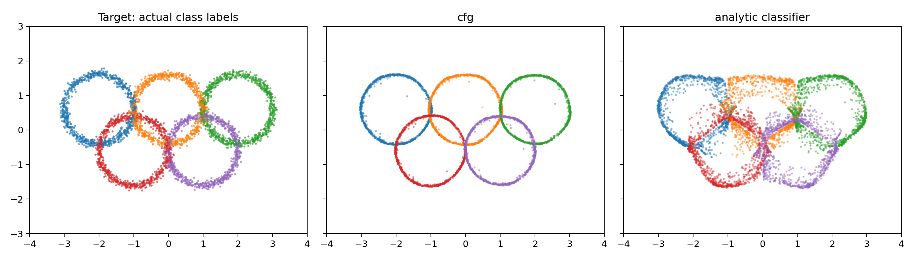
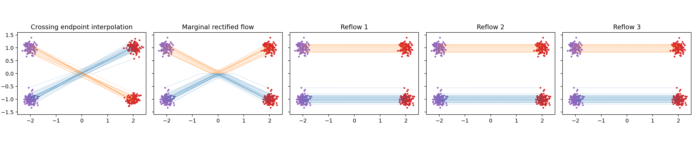
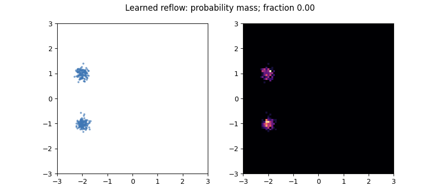
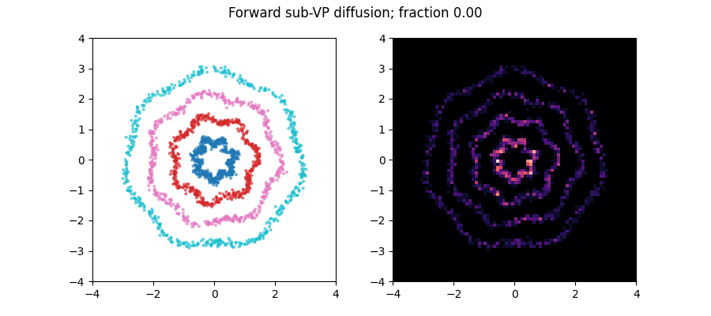

# Visual transport on richer 2D distributions

[toy_data.py](../diffusion_lab/toy_data.py) defines sampleable, labeled spirals,
pinwheels, warped checkerboards, wavy rings, galaxy arms, crescents, a deformed
lattice, a smoothed Sierpinski construction, a map-like mixture, a rose curve
and five overlapping rings. Additive Gaussian smoothing makes them suitable
for continuous-density modeling. Colors are labels used to generate the points.

The labels do not necessarily identify disjoint regions. Overlapping classes
are useful for learning why conditional generation and class inference differ.
Unlike the analytic GMM lesson, exact marginal scores are generally unknown.
Their evaluation uses sampled-reference MMD and Wasserstein distances; no
invented analytic likelihood is reported.

~~~bash
python -m diffusion_lab.toy_train --dataset olympic_rings --algorithm diffusion
python -m diffusion_lab.toy_train --dataset wavy_rings --algorithm flow
python -m diffusion_lab.toy_train --dataset warped_checkerboard
python -m diffusion_lab.toy_train --dataset two_spirals
~~~

Each conditional model learns class embeddings plus a null token. Diffusion
also supports a separately trained noisy classifier. For rings an exact noisy
class posterior is available: convolving a uniform circle with Gaussian noise
gives a density involving the modified Bessel function I0. The
[analytic classifier lesson](../diffusion_lab/toy_evaluate.py) uses its stable
exponentially scaled form to isolate guidance equations from neural classifier
gradient errors. This is explicitly an oracle reference, not a claim that an
ordinary classifier learned the exact posterior.

The saved CFG samples recover the ring geometry but are thinner than the
smoothed reference. Oracle classifier guidance avoids classifier approximation
error while still inheriting errors in the learned unconditional denoiser.
Neither panel demonstrates exact recovery of the target density.

## Linear interpolation versus marginal rectification

The first panel follows endpoint pairings that cross. The second integrates
their analytic marginal velocity field. Particles share one learned/analytic
velocity at a state; they do not retain private conflicting endpoint velocities
at a crossing. The following panels learn rectified models from teacher-produced
endpoint pairs and repeat reflow. Purple and red show endpoint distributions;
the path colors remember the starting cluster.

This is a new code-generated example inspired by the rectified-flow paper's
diagrams, not copied paper imagery. It saves transport cost and excess path
length in [reflow diagnostics](../assets/teaching/transport/reflow_diagnostics.json).
The analytic symmetric example rectifies very effectively on the first pass;
additional learned reflow can introduce small errors rather than visibly improve
an already nearly straight transport. Finite neural fits do not satisfy exact
monotonicity guarantees automatically. Compare the broader
[GMM straightness experiment](../assets/reports/diagnostics/reflow_straightness.json) too.

This GIF shows particles and their histogram moving together. It emphasizes
what the continuity equation describes: the density evolves under a field,
while the field is evaluated locally on individual particles.

## Simulate diffusion mass movement

Here the start is a labeled wavy-ring distribution, evolved under the sub-VP
forward SDE. Drift contracts it and Brownian increments disperse it. Particle
colors preserve their source labels even when the final classes overlap.
Compare the smooth particle paths of an ODE with these stochastic paths using
[the foundational SDE/ODE example](../assets/teaching/gaussian_diffusion/ode_sde_trajectories.png).

~~~bash
python -m diffusion_lab.advanced_lessons --output assets/teaching/transport
~~~

Exercise: vary smoothing, class overlap and guidance scale. Evaluate each
requested class against its own labeled reference, and compare the resulting
mixture with the unconditional model. Stronger guidance can reduce variation
inside a class rather than improve fidelity to its true distribution.

Source: [Rectified Flow](https://arxiv.org/abs/2209.03003).
