# Advanced experiments and measured results

Results below come from saved runs. Interim runs identify the actual checkpoint step;
they are not completed-budget benchmark claims. Metric protocols are in [image practice](12_image_experiments.md).

## MNIST quality versus network evaluations

All final comparisons use 2,048 generated images, balanced references, seed 123,
scale 1, and the same saved digit feature classifier. The feature distance is not Inception FID.

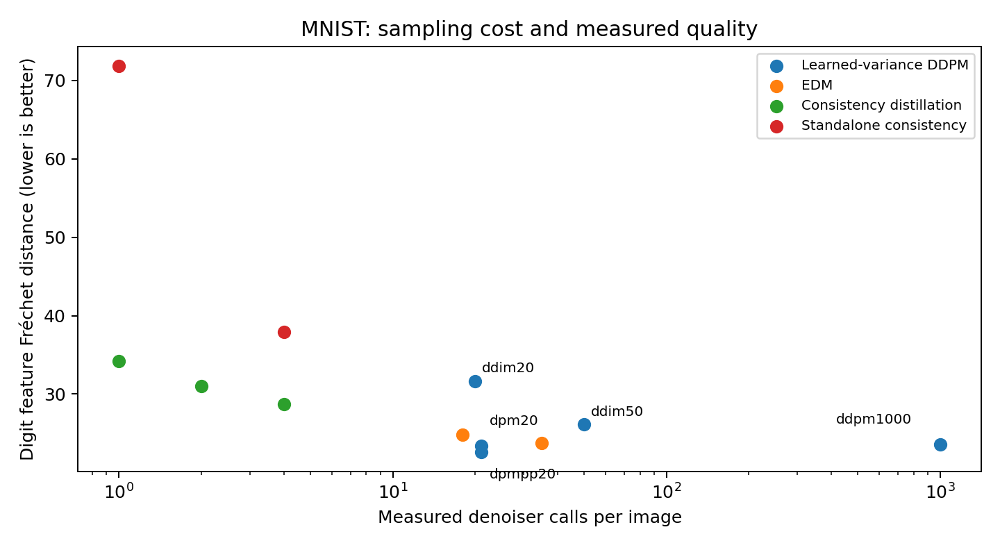

Within the learned-variance DDPM family, changing only the solver provides the fairest comparison.
EDM and consistency have different training objectives/checkpoints, so their points compare complete pipelines.

| Experiment | Training steps | Denoiser calls/image | Digit feature distance | Requested-class agreement |
|---|---:|---:|---:|---:|
| [mnist_ddpm1000](../assets/experiments/mnist/mnist_ddpm1000/metrics.json) | 20000 | 1000 | 23.584 | 0.979 |
| [mnist_ddim20](../assets/experiments/mnist/mnist_ddim20/metrics.json) | 20000 | 20 | 31.662 | 0.963 |
| [mnist_ddim50](../assets/experiments/mnist/mnist_ddim50/metrics.json) | 20000 | 50 | 26.126 | 0.964 |
| [mnist_dpm20](../assets/experiments/mnist/mnist_dpm20/metrics.json) | 20000 | 21 | 23.352 | 0.968 |
| [mnist_dpmpp20](../assets/experiments/mnist/mnist_dpmpp20/metrics.json) | 20000 | 21 | 22.594 | 0.967 |
| [mnist_edm18](../assets/experiments/mnist/mnist_edm18/metrics.json) | 20000 | 35 | 23.710 | 0.965 |
| [mnist_edm_euler18](../assets/experiments/mnist/mnist_edm_euler18/metrics.json) | 20000 | 18 | 24.815 | 0.975 |
| [mnist_cd1](../assets/experiments/mnist/mnist_cd1/metrics.json) | 20000 | 1 | 34.211 | 0.978 |
| [mnist_cd2](../assets/experiments/mnist/mnist_cd2/metrics.json) | 20000 | 2 | 31.039 | 0.950 |
| [mnist_cd4](../assets/experiments/mnist/mnist_cd4/metrics.json) | 20000 | 4 | 28.749 | 0.984 |
| [mnist_ct1](../assets/experiments/mnist/mnist_ct1/metrics.json) | 20000 | 1 | 71.860 | 0.923 |
| [mnist_ct4](../assets/experiments/mnist/mnist_ct4/metrics.json) | 20000 | 4 | 37.899 | 0.980 |

### mnist_edm18

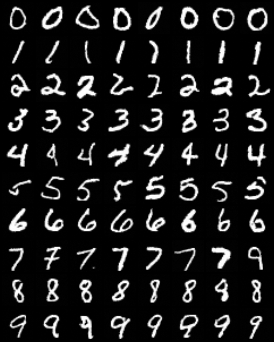

### mnist_cd1

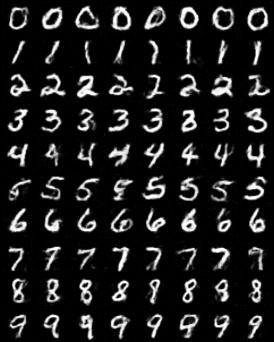

### mnist_ct4

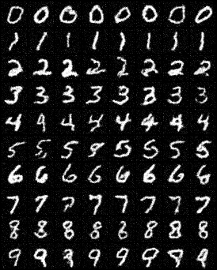

## CIFAR-10 and face images

These use the reported reference count and pretrained Inception metrics.
Small evaluations are noisy; comparisons across datasets/resolutions are not rankings.

| Experiment | Steps | Generated / real | FID | IS | Denoiser calls/image |
|---|---:|---:|---:|---:|---:|
| [cifar10_edm_balanced_progress](../assets/experiments/cifar10/cifar10_edm_balanced_progress/metrics.json) | 6000 | 2048 / 2048 | 66.77 | 5.45 | 35 |
| [cifar10_edm15k_10k_eval](../assets/experiments/cifar10/cifar10_edm15k_10k_eval/metrics.json) | 15000 | 10000 / 10000 | 29.67 | 6.94 | 35 |
| [cifar10_cfg15k_10k_eval](../assets/experiments/cifar10/cifar10_cfg15k_10k_eval/metrics.json) | 15000 | 10000 / 10000 | 21.34 | 7.76 | 70 |
| [cifar10_cfg27k_10k_eval](../assets/experiments/cifar10/cifar10_cfg27k_10k_eval/metrics.json) | 27000 | 10000 / 10000 | 15.23 | 8.27 | 70 |
| [cifar10_edm_final](../assets/experiments/cifar10/cifar10_edm_final/metrics.json) | 100000 | 10000 / 10000 | 12.72 | 8.42 | 35 |
| [cifar10_edm_cfg_final](../assets/experiments/cifar10/cifar10_edm_cfg_final/metrics.json) | 100000 | 10000 / 10000 | 8.97 | 8.96 | 70 |
| [cifar10_flow20_final](../assets/experiments/cifar10/cifar10_flow20_final/metrics.json) | 100000 | 10000 / 10000 | 22.24 | 9.53 | 80 |
| [cifar10_flow50_final](../assets/experiments/cifar10/cifar10_flow50_final/metrics.json) | 100000 | 10000 / 10000 | 10.00 | 9.13 | 200 |
| [celeba_flow_quality_progress](../assets/experiments/faces/celeba_flow_quality_progress/metrics.json) | 4000 | 2048 / 2000 | 43.57 | 2.06 | 100 |
| [celeba_flow_balanced_progress](../assets/experiments/faces/celeba_flow_balanced_progress/metrics.json) | 15000 | 2048 / 2000 | 26.26 | 2.21 | 100 |
| [celeba_flow_final](../assets/experiments/faces/celeba_flow_final/metrics.json) | 100000 | 10000 / 2000 | 16.31 | 2.27 | 100 |

### cifar10_edm_balanced_progress

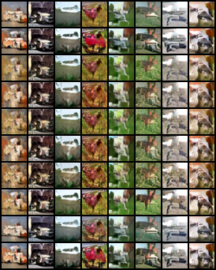

### cifar10_edm15k_10k_eval

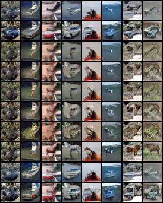

### cifar10_cfg15k_10k_eval

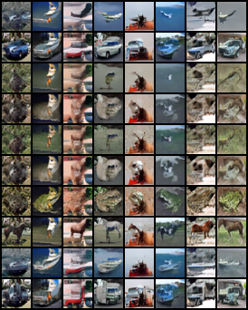

### cifar10_cfg27k_10k_eval

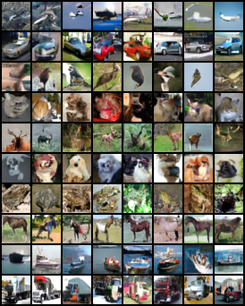

### cifar10_edm_final

### cifar10_edm_cfg_final

### cifar10_flow20_final

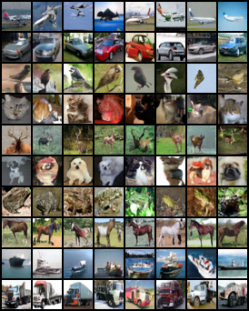

### cifar10_flow50_final

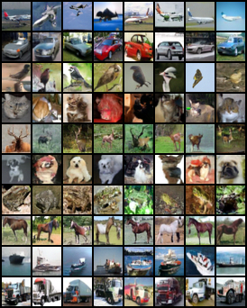

### celeba_flow_quality_progress

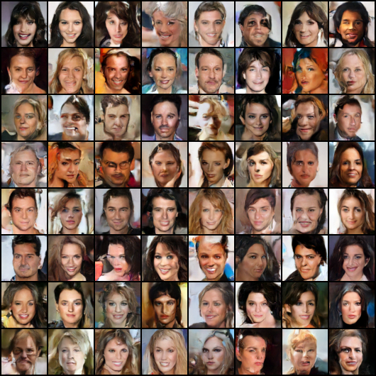

### celeba_flow_balanced_progress

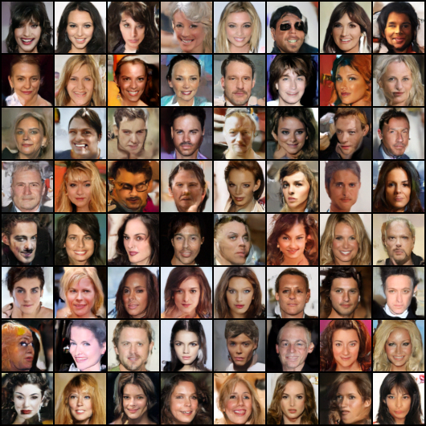

### celeba_flow_final

### cifar10_edm_final interpolation

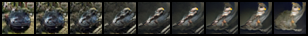

### cifar10_cfg27k_10k_eval interpolation

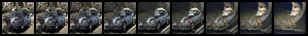

### cifar10_edm_balanced_progress interpolation

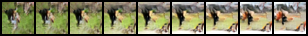

### celeba_flow_final interpolation

### celeba_flow_quality_progress interpolation

### celeba_flow_balanced_progress interpolation

### mnist_edm_balanced_progress interpolation

## Guidance

CFG is the strongest current image demonstration. Noisy classifiers have measured
held-out accuracy, but their gradients can still distort samples. Strong scales
increase requested-class agreement at a quality cost. CLIP examples use a denoised
heuristic energy and are not claimed as reliable open-vocabulary generation.

### mnist_classifier_final_digit3

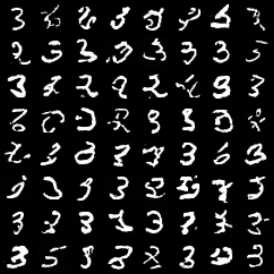

### cifar10_clip_airplane

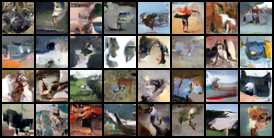

### cifar10_clip_scale0.03

### cifar10_clip_scale0.3

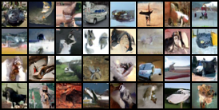

### cifar10_clip_scale1.0

### mnist guidance comparison

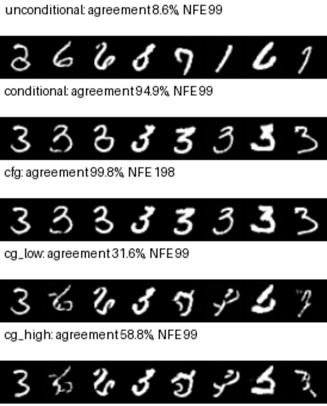

[Recorded protocol and assessment classifier](../assets/teaching/guidance/mnist_comparison.json).
The unconditional row is measured against the requested class as a baseline,
not as its unconditional distribution-quality score. CG also incurs the
separately recorded classifier calls. Guidance can exploit classifier
gradients; prefer an independent assessment classifier.

### cifar10 guidance comparison

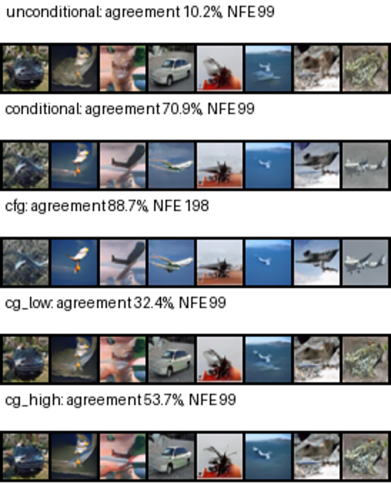

[Recorded protocol and assessment classifier](../assets/teaching/guidance/cifar10_comparison.json).
The unconditional row is measured against the requested class as a baseline,
not as its unconditional distribution-quality score. CG also incurs the
separately recorded classifier calls. Guidance can exploit classifier
gradients; prefer an independent assessment classifier.

## Alternating DSBM

Both four-cycle runs use 6,000 fitting steps per direction per cycle.

| Initialization | Final forward sliced W2 | Final backward sliced W2 |
|---|---:|---:|
| [dsbm_imf](../assets/experiments/bridges/dsbm_imf/metrics.json) | 0.172 | 0.075 |
| [dsbm_ipf](../assets/experiments/bridges/dsbm_ipf/metrics.json) | 0.132 | 0.107 |

## Rich conditional 2D data

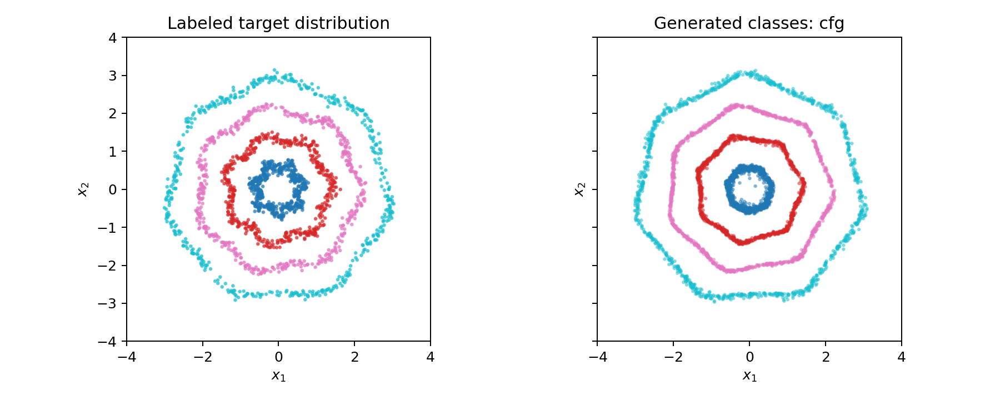

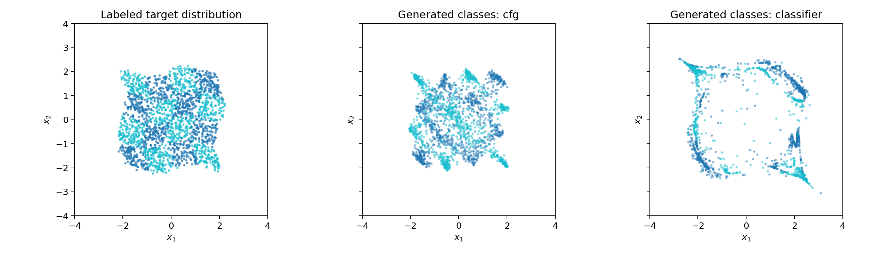

