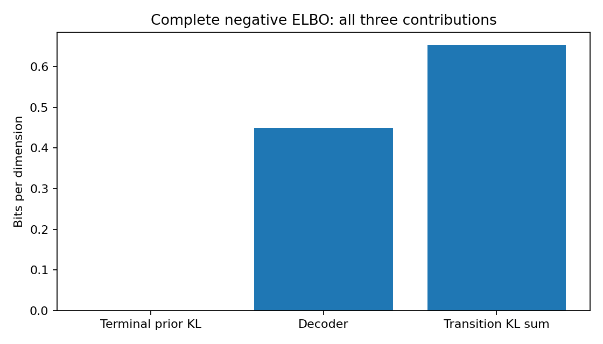
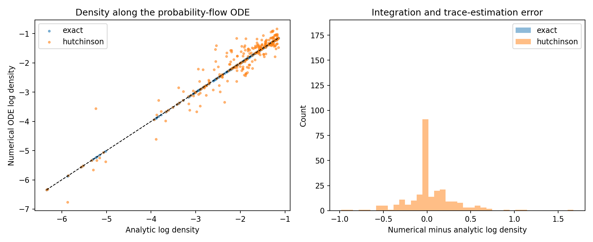

# Likelihood: a variational bound and continuous change of variables

Sample quality and probability assigned to held-out data answer different
questions. A sampler produces images; a likelihood calculation needs a normalized
generative model and a carefully defined observation space. Code lives in
[likelihood.py](../diffusion_lab/likelihood.py) and the reproducible
[experiment driver](../diffusion_lab/likelihood_experiments.py).

## The complete discrete DDPM bound

Write the forward chain as

$$q(x_{1:T}\mid x_0)=\prod_{t=1}^T
\mathcal N(x_t;\sqrt{1-\beta_t}x_{t-1},\beta_t I),$$

with $\bar\alpha_t=\prod_{s=1}^t(1-\beta_s)$. Its closed-form marginal is
$q(x_t\mid x_0)=\mathcal N(\sqrt{\bar\alpha_t}x_0,(1-\bar\alpha_t)I)$.
The reverse model is $p_\theta(x_{0:T})=p(x_T)\prod_{t=1}^T
p_\theta(x_{t-1}\mid x_t)$ with $p(x_T)=\mathcal N(0,I)$.
Jensen's inequality gives

$$-\log p_\theta(x_0)\leq
\underbrace{D_{KL}(q(x_T\mid x_0)\Vert p(x_T))}_{L_T}
+\sum_{t=2}^T\underbrace{\mathbb E_{q(x_t\mid x_0)}
D_{KL}(q(x_{t-1}\mid x_t,x_0)\Vert p_\theta(x_{t-1}\mid x_t))}_{L_{t-1}}
+\underbrace{\mathbb E_{q(x_1\mid x_0)}[-\log p_\theta(x_0\mid x_1)]}_{L_0}.$$

The posterior has mean

$$\tilde\mu_t=\frac{\sqrt{\bar\alpha_{t-1}}\beta_t}{1-\bar\alpha_t}x_0
+\frac{\sqrt{1-\beta_t}(1-\bar\alpha_{t-1})}{1-\bar\alpha_t}x_t,$$

and variance $\tilde\beta_t=\beta_t(1-\bar\alpha_{t-1})/(1-\bar\alpha_t)$.
The model substitutes its predicted clean image for $x_0$ in this mean.
Image evaluation clips this prediction to [-1,1], matching the image DDPM
sampler's reverse means; continuous toy evaluation follows its sampler config.
Training retains its unclipped mean convention. The report records clipping.
For diagonal Gaussians, the KL per coordinate is

$$\frac12\left[\log\frac{v_p}{v_q}-1+\frac{v_q}{v_p}
+\frac{(\mu_q-\mu_p)^2}{v_p}\right].$$

`ddpm_elbo` evaluates all $T-1$ transition KLs, the decoder term and the terminal
prior KL separately. The latter is

$$L_T=\tfrac12\sum_i[\bar\alpha_T x_{0,i}^2-\bar\alpha_T-
\log(1-\bar\alpha_T)].$$

It is a constant with respect to network parameters, so the training VLB can
omit it. A reported **complete** ELBO cannot. The code uses double precision
for this small terminal quantity to avoid cancellation.

For images, $L_0$ uses a discretized Gaussian: integrate probability between
the two neighboring half-bin boundaries, and include the outer tails at -1
and +1. Standard normalized 8-bit centers have spacing $2/255$. The first
posterior variance is zero, so its clipped log-variance convention uses the
second posterior variance, as in Improved DDPM. The covariance is diagonal;
learned-range variance interpolates between log posterior and log forward
variance. For continuous GMM data, the decoder is a continuous Gaussian density.
Likelihood evaluation uses float64 log-CDF differences and positive-tail
symmetry. It avoids subtracting two CDF values rounded to one, and does not
cap the reported loss with a probability floor. An independently integrated
10-standard-deviation Gaussian interval verifies this tail calculation.
The original float32/floored training decoder remains available so existing
training checkpoints keep their objective convention.
Continuous bits/dimension need not be positive.

One independent forward-noise sample per timestep estimates the expectation.
The full sum therefore still contains Monte Carlo error; it is a negative ELBO,
not an exact negative log likelihood. With `--timestep-samples M`, the driver
always evaluates the decoder, uniformly samples $M$ transition indices, and
multiplies their sum by $(T-1)/M$. This is an unbiased transition-sum estimator,
but can have substantial variance. Every result keeps the decomposition and
the estimator description.

~~~bash
python -m diffusion_lab.likelihood_experiments \
  --checkpoint outputs/mnist_improved_ddpm/checkpoint.pt \
  --samples 32 --device cuda:0 --output outputs/likelihood_mnist_full_elbo
# Faster stochastic sum, with its variance explicitly retained:
python -m diffusion_lab.likelihood_experiments \
  --checkpoint outputs/mnist_improved_ddpm/checkpoint.pt \
  --samples 32 --timestep-samples 100 --device cuda:0 \
  --output outputs/likelihood_mnist_sampled_elbo
~~~

## ODE likelihood and divergence

For $\dot x=v(x,t)$, the continuity equation implies

$$\frac{d}{dt}\log p_t(x_t)=-\nabla\cdot v(x_t,t).$$

Integrating **from observed data to the known base** gives

$$\log p_{t_a}(x_{t_a})=\log p_{t_b}(x_{t_b})+
\int_{t_a}^{t_b}\nabla\cdot v(x_t,t)\,dt.$$

This sign holds even if $t_b<t_a$. Diffusion uses increasing data-to-noise
time; our flow matcher uses decreasing data-to-noise time, from 1 to 0.
Euler, Heun and RK4 integrate the state and divergence together.
For EDM's positive noise variable, $v=(x-D_\theta(x,\sigma))/\sigma$.
For a general diffusion SDE the probability-flow field is
$f-\tfrac12g^2s_\theta$.

An exact Jacobian trace needs one gradient per coordinate and is restricted
to small dimensions. Hutchinson's identity replaces it by
$\mathbb E_e[e^T(\partial v/\partial x)e]$, where $e$ is a Rademacher vector.
Probes stay fixed during a solve. Resampling them at each ODE stage would make
the right-hand side noisy. Batch-statistic layers coupling examples invalidate
the per-example Jacobian interpretation; the provided networks avoid them.

~~~bash
python -m diffusion_lab.likelihood_experiments --steps 200 \
  --output outputs/likelihood_analytic_gmm
python -m diffusion_lab.likelihood_experiments \
  --checkpoint outputs/cifar10_edm_quality/checkpoint.pt \
  --samples 8 --steps 100 --probes 2 --device cuda:0 \
  --output outputs/likelihood_cifar10_edm
~~~

The analytic lesson uses the exact GMM density at both finite time endpoints.
It isolates integration and trace error from terminal-prior approximation.
The learned image examples retain their finite cutoff and Gaussian base
assumptions. EDM's density is evaluated at positive `sigma_min`; the sampler's
final denoising map is excluded. It is not a likelihood of that generally
noninvertible map's rendered output.

For continuous image densities, uniform dequantization maps pixel integer $k$
to $(k+u)/128-1$, $u\sim U[0,1)$. The bin width is $1/128$, giving the usual
conversion $7-\log p(x)/(D\log2)$. Small held-out batches are diagnostics, not
full test-set benchmark estimates. Increase steps, probes, examples and
repeated seeds before drawing quantitative conclusions.

Class-conditioned checkpoints evaluate $p_\theta(x\mid y)$ using the held-out
example's known class and no CFG. They do not silently report the class-marginal
$p_\theta(x)=\sum_y\pi_y p_\theta(x\mid y)$; that requires explicit class
weights and evaluation over all classes. Compare conditional results only
against the same conditioning protocol.

A latent density alone is not an image likelihood. A probabilistic decoder
and the encoder's variational contribution would be needed; the driver rejects
latent checkpoints rather than mislabeling their density as image bpd.

The stationary-Gaussian test checks the complete ELBO against its known marginal
NLL. Affine forward/backward ODE tests check the density sign independently.
See [measured extension results](21_extension_results.md) and
[Improved DDPM](https://arxiv.org/abs/2102.09672).
