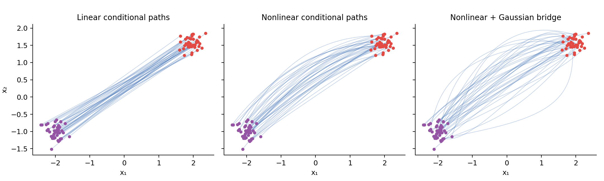

# General stochastic interpolants

A stochastic interpolant specifies an entire family of intermediate random
variables between two endpoint distributions. It connects flow matching and
diffusion without requiring the endpoints to be data and standard Gaussian.
[interpolants.py](../diffusion_lab/interpolants.py) exposes the construction,
its regression targets and exact GMM fields.

Draw $(X_0,X_1)$ from a chosen coupling and independent $Z\sim\mathcal N(0,I)$.
Define

$$I_t=a(t)X_0+b(t)X_1+\gamma(t)Z,\qquad 0\leq t\leq1.$$

Endpoint constraints are $(a(0),b(0),\gamma(0))=(1,0,0)$ and
$(a(1),b(1),\gamma(1))=(0,1,0)$. Our three coefficient families are:

| Path | $a(t)$ | $b(t)$ |
|---|---|---|
| Linear | $1-t$ | $t$ |
| Trigonometric | $\cos(\pi t/2)$ | $\sin(\pi t/2)$ |
| Cubic easing | $1-3t^2+2t^3$ | $3t^2-2t^3$ |

The presets use $\gamma(t)=A\sin(\pi t)$, with configurable $A>0$.
Pass a differentiable `noise_std_fn(t)` to choose a different Gaussian-noise
schedule; a JVP computes its derivative. It must be nonnegative, positive in
the open interval for the score identity, and zero at both endpoints.
The API also accepts a differentiable `base_fn(source, target, t)` for a
nonlinear endpoint path. A JVP computes its time derivative automatically;
the callable must preserve shape, act independently on examples and satisfy
both endpoint constraints. The Gaussian noise head and matching SDE identities
still apply. The exact GMM oracle is restricted to affine endpoint paths.

~~~python
from diffusion_lab.interpolants import StochasticInterpolant
from diffusion_lab.paths import expand

def curved_base(source, target, t):
    return (
        expand(1 - t, source) * source
        + expand(t, source) * target
        + expand(t * (1 - t), source) * (source + target).sin()
    )

process = StochasticInterpolant(base_fn=curved_base, noise_std_fn=lambda t: 2 * t * (1 - t))
# noisy_state, velocity_target, noise_target = process.targets(source, target, t)
~~~

This figure plots sampled conditional paths, with the nonlinear term amplified
for visibility. They are not learned marginal ODE trajectories; learning the
conditional expected derivative is the additional step required for generation.
`targets` also accepts already-coupled endpoints; the training examples use
independent Gaussian source/target draws. Changing the coupling changes the
conditional regression problem and paths.

## Two conditional expectations

Differentiate the sampled path to obtain
$U_t=\dot aX_0+\dot bX_1+\dot\gamma Z$. Squared velocity regression learns

$$v_t(x)=\mathbb E[U_t\mid I_t=x].$$

Gaussian integration by parts gives the marginal score

$$s_t(x)=\nabla\log\rho_t(x)=-\frac{\mathbb E[Z\mid I_t=x]}{\gamma(t)}.$$

The network returns two heads, velocity and conditional noise. Training the
noise head against $Z$ avoids explicit division by small $\gamma$ in the loss.
Training times lie strictly inside (0,1); the code never defines an endpoint
score by dividing by zero. Class dropout gives both conditional and null heads
for CFG, with labels attached to the target endpoint.

The marginal velocity satisfies the continuity equation
$\partial_t\rho_t=-\nabla\cdot(\rho_t v_t)$. Therefore its ODE transports the
endpoint distributions. An individual sampled interpolant path generally
does **not** solve this ODE: its derivative depends on hidden endpoints and $Z$,
whereas the ODE uses their conditional expectation given the current position.

## A family of SDEs with the same marginals

For any nonnegative scalar $\epsilon(t)$ independent of position,

$$dX_t=[v_t(X_t)+\epsilon(t)s_t(X_t)]dt+
\sqrt{2\epsilon(t)}dW_t.$$

Substitute into Fokker–Planck:

$$\partial_t\rho=-\nabla\cdot(\rho v)-\epsilon\nabla\cdot(\rho s)
+\epsilon\Delta\rho=-\nabla\cdot(\rho v),$$

since $\rho s=\nabla\rho$. The matching backward-clock drift is
$v-\epsilon s$, integrated with negative $dt$ and Brownian increments of
variance $|dt|$. Adding Brownian noise to the ODE without the score correction
does not preserve these marginals.

Our stable example chooses $\epsilon=\kappa\gamma^2$. Its learned forward drift
is $\hat v-\kappa\gamma\hat Z$ and noise coefficient
$\sqrt{2\kappa}\gamma$. This cancels the dangerous score denominator and
turns off diffusion at both endpoints. At $\kappa=0$ it becomes the ODE.
The implementation validates $\kappa\geq0$.

~~~bash
# Reproduce the conditional-path illustration (distinct from marginal ODE paths).
python -m scripts.build_interpolant_figures --output assets/teaching/interpolants
# Exact Gaussian-mixture fields: isolate sampling error from learning error.
python -m diffusion_lab.interpolant_experiments --oracle-only --device cpu \
  --output outputs/interpolant_oracle
# Learned conditional velocity AND noise fields on rich geometries.
python -m diffusion_lab.interpolant_experiments --dataset wavy_rings \
  --path linear --amplitude 0.5 --steps 15000 --device cuda:0 \
  --output outputs/wavy_rings_stochastic_interpolant
# Choose gmm, two_spirals, pinwheel, checkerboard and the other toy datasets.
~~~

Every learned run evaluates $\kappa=0,0.5,2$, saves moving-particle GIFs,
colored endpoint comparisons, MMD and Wasserstein diagnostics, weights, optimizer
and RNG. Learned ODE/SDE samples need not match perfectly: both regression
error and discretization error remain. Comparing exact oracle fields with learned
fields reveals which error is responsible.

For independent isotropic GMM endpoints, each pair of mixture components remains
Gaussian with mean $am_0+bm_1$ and variance $a^2s_0^2+b^2s_1^2+\gamma^2$.
`GaussianInterpolantOracle` computes mixture responsibilities, score and velocity
analytically. Tests check continuity and Fokker–Planck residuals using autograd
for all three paths, including nonzero diffusion.

See [the source paper](https://arxiv.org/abs/2303.08797),
[flows and transport](03_flows_and_transport.md) and
[measured results](21_extension_results.md). Schrödinger bridges require an
additional optimization over dynamics/couplings; an arbitrary interpolant
alone does not establish the entropy-minimizing bridge.
