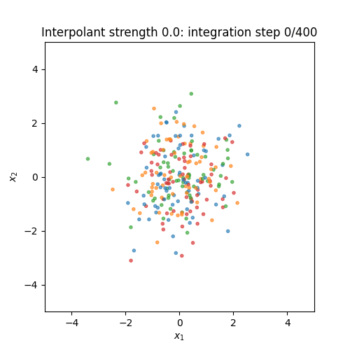
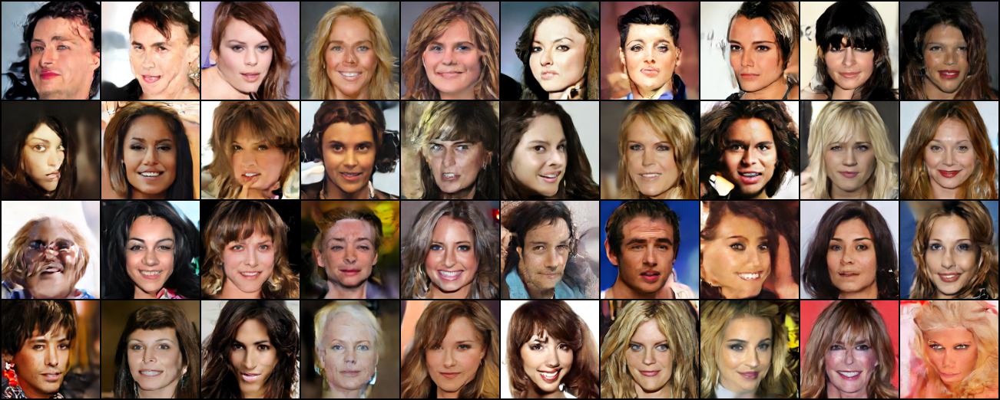

# Extension results: likelihood, interpolants, fast generation and latent DiT

This page is generated from actual reports. Configured budgets are separate
from completed training and measured final quality. Interim previews are
labeled as such; no paper benchmark score is claimed.

## Likelihood diagnostics

All image values below are conditional on the held-out class label, without CFG.
Small batches are demonstrations, not full test-set benchmark estimates.

| Experiment | Examples | Quantity | Measured value |
|---|---:|---|---:|
| [likelihood_mnist_full_elbo](../assets/experiments/likelihood/likelihood_mnist_full_elbo/metrics.json) | 32 | negative ELBO, bpd | 1.1015 |
| [likelihood_mnist_sampled_elbo](../assets/experiments/likelihood/likelihood_mnist_sampled_elbo/metrics.json) | 32 | negative ELBO, bpd | 1.0170 |
| [likelihood_mnist_full_elbo_unclipped](../assets/experiments/likelihood/likelihood_mnist_full_elbo_unclipped/metrics.json) | 32 | negative ELBO, bpd | 1.1741 |
| [likelihood_mnist_edm](../assets/experiments/likelihood/likelihood_mnist_edm/metrics.json) | 16 | ODE bpd estimate | 1.2013 |
| [likelihood_cifar10_edm](../assets/experiments/likelihood/likelihood_cifar10_edm/metrics.json) | 8 | ODE bpd estimate | 3.6465 |
| [likelihood_cifar10_edm_200steps](../assets/experiments/likelihood/likelihood_cifar10_edm_200steps/metrics.json) | 8 | ODE bpd estimate | 3.6621 |
| [likelihood_cifar10_flow](../assets/experiments/likelihood/likelihood_cifar10_flow/metrics.json) | 8 | ODE bpd estimate | 3.6210 |
| [likelihood_gmm_flow](../assets/experiments/likelihood/likelihood_gmm_flow/metrics.json) | 512 | ODE log density, nats | -2.1491 |
| [likelihood_gmm_ddpm_epsilon](../assets/experiments/likelihood/likelihood_gmm_ddpm_epsilon/metrics.json) | 512 | negative ELBO, bpd | 2.3941 |

Analytic GMM: exact-trace log-density RMSE **7.77e-07**;
8-probe Hutchinson RMSE **0.299** on 256 samples.
The same exact finite-time GMM terminal density isolates integration/trace error.

## Learned stochastic interpolants

All three datasets completed 15,000 optimizer updates. Each row uses 2,048
generated/reference points, conditional labels, and 400 integration steps.

| Dataset | Diffusion strength | Sliced W₂ ↓ | Unbiased MMD² |
|---|---:|---:|---:|
| [gmm](../assets/experiments/toy/gmm_stochastic_interpolant/strength_0.0/metrics.json) | 0.0 | 0.0325 | -0.00047 |
| [gmm](../assets/experiments/toy/gmm_stochastic_interpolant/strength_0.5/metrics.json) | 0.5 | 0.0320 | -0.00050 |
| [gmm](../assets/experiments/toy/gmm_stochastic_interpolant/strength_2.0/metrics.json) | 2.0 | 0.0304 | -0.00053 |
| [wavy_rings](../assets/experiments/toy/wavy_rings_stochastic_interpolant/strength_0.0/metrics.json) | 0.0 | 0.0433 | -0.00032 |
| [wavy_rings](../assets/experiments/toy/wavy_rings_stochastic_interpolant/strength_0.5/metrics.json) | 0.5 | 0.0483 | -0.00029 |
| [wavy_rings](../assets/experiments/toy/wavy_rings_stochastic_interpolant/strength_2.0/metrics.json) | 2.0 | 0.0654 | -0.00017 |
| [two_spirals](../assets/experiments/toy/two_spirals_stochastic_interpolant/strength_0.0/metrics.json) | 0.0 | 0.0506 | -0.00004 |
| [two_spirals](../assets/experiments/toy/two_spirals_stochastic_interpolant/strength_0.5/metrics.json) | 0.5 | 0.0403 | -0.00028 |
| [two_spirals](../assets/experiments/toy/two_spirals_stochastic_interpolant/strength_2.0/metrics.json) | 2.0 | 0.0453 | 0.00008 |

An unbiased finite-sample MMD estimate can be negative. ODE and SDE agreement
is exact only with exact fields and integration; learned fits retain error.

## Distribution quality beyond FID

| RGB experiment | Precision | Recall | Density | Coverage |
|---|---:|---:|---:|---:|
| [cifar10_edm_final](../assets/reports/distribution_quality/rgb/cifar10_edm_final/metrics.json) | 0.644 | 0.619 | 0.849 | 0.745 |
| [cifar10_edm_cfg_final](../assets/reports/distribution_quality/rgb/cifar10_edm_cfg_final/metrics.json) | 0.722 | 0.572 | 1.135 | 0.857 |
| [cifar10_flow20_final](../assets/reports/distribution_quality/rgb/cifar10_flow20_final/metrics.json) | 0.622 | 0.467 | 0.787 | 0.708 |
| [cifar10_flow50_final](../assets/reports/distribution_quality/rgb/cifar10_flow50_final/metrics.json) | 0.738 | 0.566 | 1.123 | 0.853 |
| [celeba_flow_final](../assets/reports/distribution_quality/rgb/celeba_flow_final/metrics.json) | 0.701 | 0.497 | 0.936 | 0.758 |

CIFAR uses 2,048/2,048 Inception features; the face example has 2,000 references.
Compare only matching data, representation, counts and k=3. Per-class reports
and equal-size training/held-out nearest-neighbor galleries are retained.

### Additional coverage diagnostics: interim_digits

Compare within matching data, features, counts and k; digit and RGB spaces differ.

| Experiment | Precision | Recall | Density | Coverage |
|---|---:|---:|---:|---:|
| [mnist_progressive_teacher32](../assets/reports/distribution_quality/interim_digits/mnist_progressive_teacher32/metrics.json) | 0.775 | 0.846 | 0.769 | 0.733 |
| [mnist_progressive_1_eval](../assets/reports/distribution_quality/interim_digits/mnist_progressive_1_eval/metrics.json) | 0.767 | 0.834 | 0.739 | 0.690 |
| [mnist_progressive_2_eval](../assets/reports/distribution_quality/interim_digits/mnist_progressive_2_eval/metrics.json) | 0.757 | 0.839 | 0.737 | 0.708 |
| [mnist_ict_corrected_5k1](../assets/reports/distribution_quality/interim_digits/mnist_ict_corrected_5k1/metrics.json) | 0.763 | 0.451 | 0.756 | 0.572 |
| [mnist_ict_corrected_5k4](../assets/reports/distribution_quality/interim_digits/mnist_ict_corrected_5k4/metrics.json) | 0.856 | 0.623 | 1.028 | 0.730 |

### Additional coverage diagnostics: interim_rgb

Compare within matching data, features, counts and k; digit and RGB spaces differ.

| Experiment | Precision | Recall | Density | Coverage |
|---|---:|---:|---:|---:|
| [cifar10_dit_30k](../assets/reports/distribution_quality/interim_rgb/cifar10_dit_30k/metrics.json) | 0.622 | 0.584 | 0.751 | 0.606 |
| [celeba128_latent_dit_30k](../assets/reports/distribution_quality/interim_rgb/celeba128_latent_dit_30k/metrics.json) | 0.542 | 0.385 | 0.519 | 0.504 |
| [celeba128_latent_unet_20k](../assets/reports/distribution_quality/interim_rgb/celeba128_latent_unet_20k/metrics.json) | 0.507 | 0.300 | 0.428 | 0.403 |

### Additional coverage diagnostics: extension_digits

Compare within matching data, features, counts and k; digit and RGB spaces differ.

| Experiment | Precision | Recall | Density | Coverage |
|---|---:|---:|---:|---:|
| [mnist_ict_corrected1](../assets/reports/distribution_quality/extension_digits/mnist_ict_corrected1/metrics.json) | 0.707 | 0.860 | 0.630 | 0.658 |
| [mnist_ict_corrected2](../assets/reports/distribution_quality/extension_digits/mnist_ict_corrected2/metrics.json) | 0.665 | 0.894 | 0.538 | 0.612 |
| [mnist_ict_corrected4](../assets/reports/distribution_quality/extension_digits/mnist_ict_corrected4/metrics.json) | 0.770 | 0.831 | 0.742 | 0.713 |

### Additional coverage diagnostics: extension_rgb

Compare within matching data, features, counts and k; digit and RGB spaces differ.

| Experiment | Precision | Recall | Density | Coverage |
|---|---:|---:|---:|---:|
| [cifar10_dit_final](../assets/reports/distribution_quality/extension_rgb/cifar10_dit_final/metrics.json) | 0.612 | 0.640 | 0.800 | 0.724 |
| [cifar10_dit_cfg_final](../assets/reports/distribution_quality/extension_rgb/cifar10_dit_cfg_final/metrics.json) | 0.715 | 0.588 | 1.149 | 0.850 |
| [celeba128_latent_unet_final](../assets/reports/distribution_quality/extension_rgb/celeba128_latent_unet_final/metrics.json) | 0.557 | 0.426 | 0.534 | 0.539 |
| [celeba128_latent_dit_final](../assets/reports/distribution_quality/extension_rgb/celeba128_latent_dit_final/metrics.json) | 0.595 | 0.468 | 0.662 | 0.620 |
| [cifar10_cd1](../assets/reports/distribution_quality/extension_rgb/cifar10_cd1/metrics.json) | 0.643 | 0.500 | 0.795 | 0.649 |
| [cifar10_cd2](../assets/reports/distribution_quality/extension_rgb/cifar10_cd2/metrics.json) | 0.322 | 0.362 | 0.218 | 0.224 |
| [cifar10_cd4](../assets/reports/distribution_quality/extension_rgb/cifar10_cd4/metrics.json) | 0.271 | 0.319 | 0.164 | 0.184 |

Three independent CIFAR generation seeds at 2,048/2,048 samples: mean FID
**27.72**, Student-t 95% interval **[27.19, 28.24]**.
This smaller-reference protocol is not comparable to the 10k/10k final FID.
The interval excludes training and reference-sampling uncertainty.
[Complete repeated-seed report](../assets/reports/distribution_quality/seed_intervals.json).

## Stronger few-step experiments

The following rows share the independent clean digit assessor and 2,048
held-out/generated images. Its feature distance is not Inception FID.

| MNIST method | Network calls | Digit feature distance ↓ | Requested-class accuracy |
|---|---:|---:|---:|
| [mnist_progressive_teacher32](../assets/experiments/mnist/mnist_progressive_teacher32/metrics.json) | 32 | 44.17 | 0.957 |
| [mnist_progressive_16_eval](../assets/experiments/mnist/mnist_progressive_16_eval/metrics.json) | 16 | 43.75 | 0.958 |
| [mnist_progressive_8_eval](../assets/experiments/mnist/mnist_progressive_8_eval/metrics.json) | 8 | 44.16 | 0.958 |
| [mnist_progressive_4_eval](../assets/experiments/mnist/mnist_progressive_4_eval/metrics.json) | 4 | 44.61 | 0.960 |
| [mnist_progressive_2_eval](../assets/experiments/mnist/mnist_progressive_2_eval/metrics.json) | 2 | 45.61 | 0.965 |
| [mnist_progressive_1_eval](../assets/experiments/mnist/mnist_progressive_1_eval/metrics.json) | 1 | 47.32 | 0.963 |
| [mnist_ict1](../assets/experiments/mnist/mnist_ict1/metrics.json) | 1 | 17469.27 | 0.097 |
| [mnist_ict2](../assets/experiments/mnist/mnist_ict2/metrics.json) | 2 | 11467.15 | 0.102 |
| [mnist_ict4](../assets/experiments/mnist/mnist_ict4/metrics.json) | 4 | 7704.59 | 0.093 |
| [mnist_ict_smooth1](../assets/experiments/mnist/mnist_ict_smooth1/metrics.json) | 1 | 17469.27 | 0.097 |
| [mnist_ict_smooth2](../assets/experiments/mnist/mnist_ict_smooth2/metrics.json) | 2 | 11467.15 | 0.102 |
| [mnist_ict_smooth4](../assets/experiments/mnist/mnist_ict_smooth4/metrics.json) | 4 | 7704.59 | 0.093 |
| [mnist_ict_corrected1](../assets/experiments/mnist/mnist_ict_corrected1/metrics.json) | 1 | 43.60 | 0.961 |
| [mnist_ict_corrected2](../assets/experiments/mnist/mnist_ict_corrected2/metrics.json) | 2 | 45.21 | 0.934 |
| [mnist_ict_corrected4](../assets/experiments/mnist/mnist_ict_corrected4/metrics.json) | 4 | 40.78 | 0.965 |
| [mnist_ict_corrected_5k1](../assets/experiments/mnist/mnist_ict_corrected_5k1/metrics.json) | 1 | 112.50 | 0.985 |
| [mnist_ict_corrected_5k4](../assets/experiments/mnist/mnist_ict_corrected_5k4/metrics.json) | 4 | 67.86 | 0.988 |

The first two iCT runs were invalidated by an autocast weight-cache bug:
the detached online-target forward prevented convolution/linear gradients.
They are retained as failed implementation diagnostics, not method benchmarks.
The corrected run keeps the smooth recipe and evaluates the student first.
Rows containing `5k` are immutable 5,000-update interim checkpoints;
they do not establish completion of the 40,000-update corrected budget.

## DiT, latent diffusion and CIFAR distillation

The latent cache contains 28,000 training and 2,000 held-out 128px faces.
The external frozen VAE alone is pretrained. Posterior-mean reconstruction
PSNR is 32.11 dB on 128 held-out images; denoisers start from scratch.

| Training run | Latest saved step / budget | Status |
|---|---:|---|
| cifar10_dit_quality | 100,000 / 100,000 | Training completed; see measured evaluation rows below |
| celeba128_latent_unet_quality | 100,000 / 100,000 | Training completed; see measured evaluation rows below |
| celeba128_latent_dit_quality | 100,000 / 100,000 | Training completed; see measured evaluation rows below |
| cifar10_consistency_distilled | 30,000 / 30,000 | Training completed; see measured evaluation rows below |
| mnist_ict_quality | 20,000 / 20,000 | Training completed; see measured evaluation rows below |
| mnist_ict_smooth_quality | 40,000 / 40,000 | Training completed; see measured evaluation rows below |
| mnist_ict_corrected_quality | 40,000 / 40,000 | Training completed; see measured evaluation rows below |

Previews below are fixed-seed progress snapshots. Their metadata records the
actual step. They are not substitutes for a completed final metric evaluation.

| Completed RGB evaluation | Generated / reference | FID ↓ | IS ↑ | Calls |
|---|---:|---:|---:|---:|
| [cifar10_dit_final](../assets/experiments/cifar10/cifar10_dit_final/metrics.json) | 10000 / 10000 | 12.75 | 8.57 | 35 |
| [cifar10_dit_cfg_final](../assets/experiments/cifar10/cifar10_dit_cfg_final/metrics.json) | 10000 / 10000 | 8.93 | 9.27 | 70 |
| [celeba128_latent_unet_final](../assets/experiments/faces/celeba128_latent_unet_final/metrics.json) | 10000 / 2000 | 27.25 | 2.71 | 35 |
| [celeba128_latent_dit_final](../assets/experiments/faces/celeba128_latent_dit_final/metrics.json) | 10000 / 2000 | 23.72 | 2.71 | 35 |
| [cifar10_cd1](../assets/experiments/cifar10/cifar10_cd1/metrics.json) | 10000 / 10000 | 22.22 | 7.60 | 1 |
| [cifar10_cd2](../assets/experiments/cifar10/cifar10_cd2/metrics.json) | 10000 / 10000 | 69.57 | 6.89 | 2 |
| [cifar10_cd4](../assets/experiments/cifar10/cifar10_cd4/metrics.json) | 10000 / 10000 | 83.41 | 6.56 | 4 |

### Immutable interim evaluations

These use 2,048 generated images and 2,048 CIFAR / 2,000 face references.
They are progress diagnostics, not completed final benchmark results.

| Interim model | Training updates | FID ↓ | IS ↑ |
|---|---:|---:|---:|
| [cifar10_dit_30k](../assets/experiments/cifar10/cifar10_dit_30k/metrics.json) | 30000 | 37.38 | 7.82 |
| [celeba128_latent_dit_30k](../assets/experiments/faces/celeba128_latent_dit_30k/metrics.json) | 30000 | 36.00 | 2.60 |
| [celeba128_latent_unet_20k](../assets/experiments/faces/celeba128_latent_unet_20k/metrics.json) | 20000 | 41.11 | 2.53 |

Final evaluations wait for training_complete.json and verify the loaded weight
hash. Checkpoints, optimizer/RNG state and immutable milestones stay in outputs/.
The public assets contain figures, configurations and measured reports.
