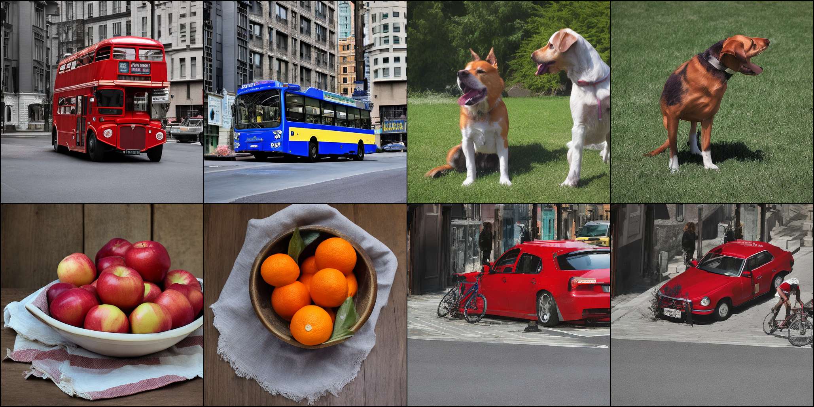
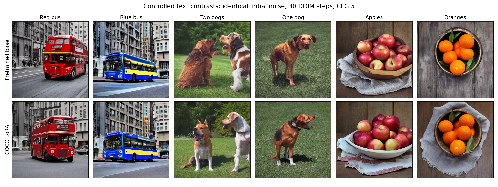
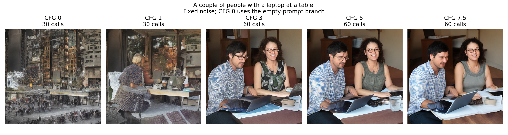
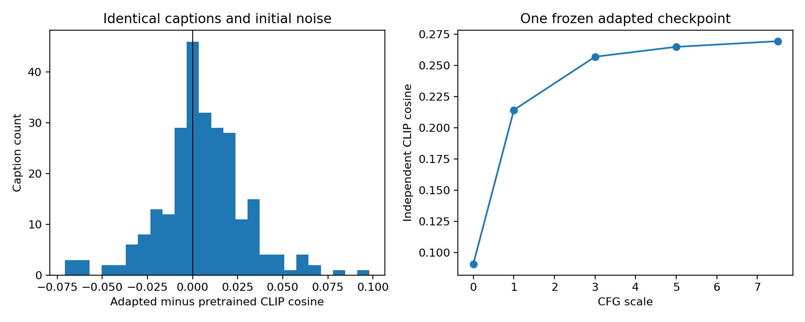

# Curriculum, stronger evidence and COCO text results — version 0.4

The original version 0.4 curriculum used seven introductory CPU notebooks.
The October 6 revision expands them into [ten guided lessons](../notebooks/README.md)
with worked derivations, short training experiments, animations and exercises.
Training/evaluation results below are generated from saved reports; smoke runs are integration checks.

## Completed data and lessons

- The current ten notebooks execute their default cells and assertions; [validation](../assets/reports/diagnostics/notebook_validation.json) records the fresh-kernel checks and their scope.
- COCO 2017 train: 118,287 images / 591,753 captions; val: 5,000 images / 25,014 captions. All images decoded and matched annotation dimensions; extracted ZIP members passed CRC checks, with local hashes recorded in [verification](../assets/reports/datasets/coco2017_verification.json).

## Frozen consistency student: refinement remains weak

The old scores and this study use different reference/generation counts; compare within a protocol. Schedules were selected on 1k/1k, then evaluated on a disjoint 5k reference subset with a new generation seed.

| Calls | Selected sigma levels | FID, 5k/5k | IS |
|---:|---|---:|---:|
| 1 | [80.0] | 27.66 | 7.47 |
| 2 | [80.0, 10.0] | 34.20 | 7.71 |
| 4 | [80.0, 3.0, 1.0, 0.3] | 105.62 | 5.85 |

Refinement did not beat one call in this sweep. The denoising profile flags large intermediate-noise errors but does not prove a unique cause. [Protocol and limits](25_evidence_studies.md).

## Expanded image likelihood diagnostics

| Case | Examples | Quantity | Mean bpd | 95% interval across examples |
|---|---:|---|---:|---|
| mnist_elbo | 1024 | DDPM negative ELBO | 1.0902 | [1.0754, 1.1051] |
| mnist_edm | 1024 | Numerical ODE density | 1.1686 | [1.1547, 1.1824] |
| cifar_edm | 512 | Numerical ODE density | 3.3549 | [3.3020, 3.4079] |
| cifar_edm_grid200 | 128 | Numerical ODE density | 3.3621 | [3.2529, 3.4712] |
| cifar_edm_probes4 | 128 | Numerical ODE density | 3.3456 | [3.2364, 3.4549] |
| cifar_edm_noise124 | 128 | Numerical ODE density | 3.3403 | [3.2308, 3.4498] |

These are known-class conditional estimates, without CFG. Example intervals do not establish numerical convergence or remove truncation/trace/Monte Carlo bias. Grid/probe comparisons use the first 128 CIFAR examples; compare to the same subset rather than the full 512-example mean.
[Matched numerical sensitivity](../assets/studies/expanded_likelihood_study/paired_sensitivity.json) and per-example bpd files retain the actual values and batch provenance.

Matched CIFAR baseline (first 128 examples): **3.3454 bpd**. Changing 100 to 200 Heun steps changes mean bpd by **+0.0167**; the finite grid is therefore a material part of this diagnostic.

## Independently trained models

GMM: three DDPM and three flow checkpoints, 6,000 updates each. Sampling uses 100 measured model calls, seed 123 and a separate reference seed 999.

| Model | Sliced W2 mean | Training-seed SD | 95% training-seed interval |
|---|---:|---:|---|
| ddpm | 0.1886 | 0.0270 | [0.1216, 0.2557] |
| flow | 0.1643 | 0.0071 | [0.1465, 0.1820] |

MNIST: three EDM and three flow models use the same U-Net, 20,000 updates, ordinary class conditioning, 2,048 reference/generated digits and an independent digit assessor. EDM uses 31 versus flow 32 calls. Digit feature distance is not Inception FID.

| Model | Completed training seeds | Digit feature distance mean ± seed SD | Requested-class accuracy mean |
|---|---|---|---|
| edm | 42,43,44 | 36.69 ± 0.70 | 95.7% |
| flow | 42,43,44 | 35.78 ± 0.34 | 97.6% |

These controlled comparisons do not estimate training uncertainty for the earlier CIFAR/face headline models.

## COCO text fine-tuning and matched pretrained baseline

Status: **COCO training and matched evaluations completed**.

LoRA adapts local pretrained SD2 attention projections at 512px; the VAE and text encoder remain frozen. The compact text U-Net is implemented/tested and configured for scratch training, but this chapter does not claim a completed full-budget scratch COCO run.
The 3,000-update adapter budget presents 24,000 image-caption pairs; it does not cover a full COCO epoch.

| Evaluation | Weights | CFG | Captions | CLIP cosine | Paired minus mismatched cosine | Calls/image |
|---|---|---:|---:|---:|---:|---:|
| [coco_text_base](../assets/experiments/text/coco_text_base/metrics.json) | base | 5.0 | 256 | 0.2591 | 0.1817 | 60 |
| [coco_text_base_pairs](../assets/experiments/text/coco_text_base_pairs/metrics.json) | base | 5.0 | 8 | 0.2633 | 0.1097 | 60 |
| [coco_text_cfg0](../assets/experiments/text/coco_text_cfg0/metrics.json) | ema | 0.0 | 256 | 0.0911 | -0.0034 | 30 |
| [coco_text_cfg1](../assets/experiments/text/coco_text_cfg1/metrics.json) | ema | 1.0 | 256 | 0.2143 | 0.1219 | 30 |
| [coco_text_cfg3](../assets/experiments/text/coco_text_cfg3/metrics.json) | ema | 3.0 | 256 | 0.2568 | 0.1718 | 60 |
| [coco_text_cfg75](../assets/experiments/text/coco_text_cfg75/metrics.json) | ema | 7.5 | 256 | 0.2692 | 0.1898 | 60 |
| [coco_text_lora](../assets/experiments/text/coco_text_lora/metrics.json) | ema | 5.0 | 256 | 0.2647 | 0.1841 | 60 |
| [coco_text_lora_pairs](../assets/experiments/text/coco_text_lora_pairs/metrics.json) | ema | 5.0 | 8 | 0.2573 | 0.1067 | 60 |

CLIP is an independent broad-alignment diagnostic, not a counting/spatial-binding benchmark. These 256-caption runs do not report headline FID. External pretraining overlap is unknown. Base/adapted comparisons use identical captions, batch sizes and initial-noise seeds. Prompt-pair grids use identical noise for every prompt and show the first eight outputs at original resolution.

coco_text_base_pairs: CLIP prefers the intended caption in 100% of six controlled decisions. Both base and adapted models pass these small contrasts; this does not establish superior counting or anatomy. The two final prompts are paraphrases, excluded from contrast scoring.

coco_text_lora_pairs: CLIP prefers the intended caption in 100% of six controlled decisions. Both base and adapted models pass these small contrasts; this does not establish superior counting or anatomy. The two final prompts are paraphrases, excluded from contrast scoring.

Matched base/adapted CLIP cosine difference: **+0.0056**, caption-wise 95% interval [+0.0026, +0.0086]. This is one fine-tuning run and does not establish a general perceptual-quality improvement. [Per-caption evidence](../assets/studies/text_alignment_study/metrics.json).

