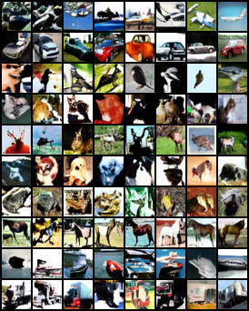
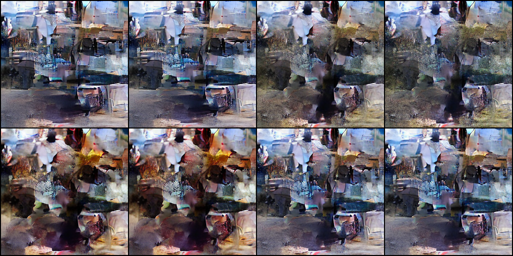
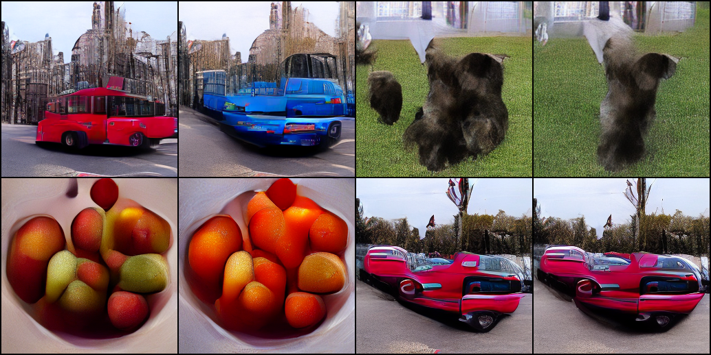
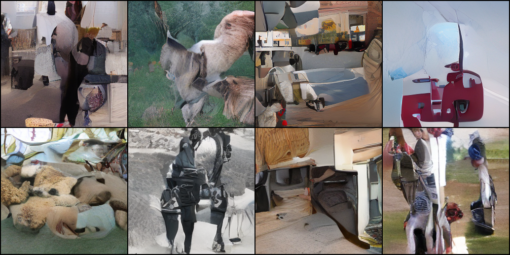
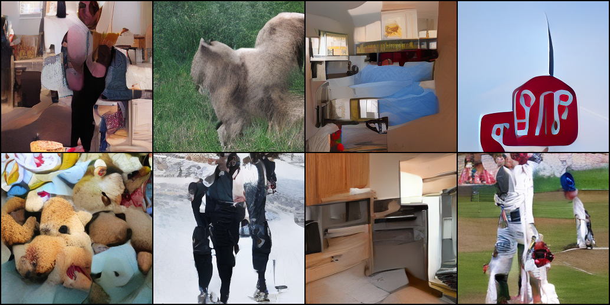
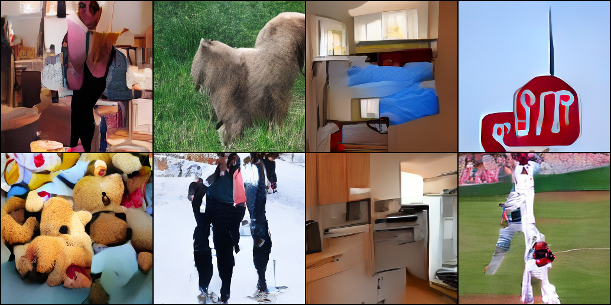
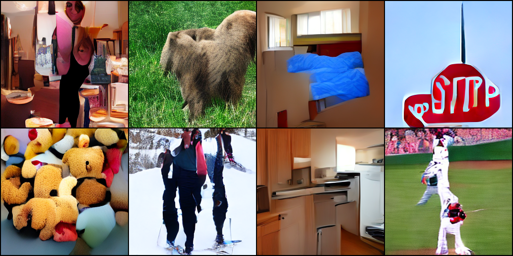
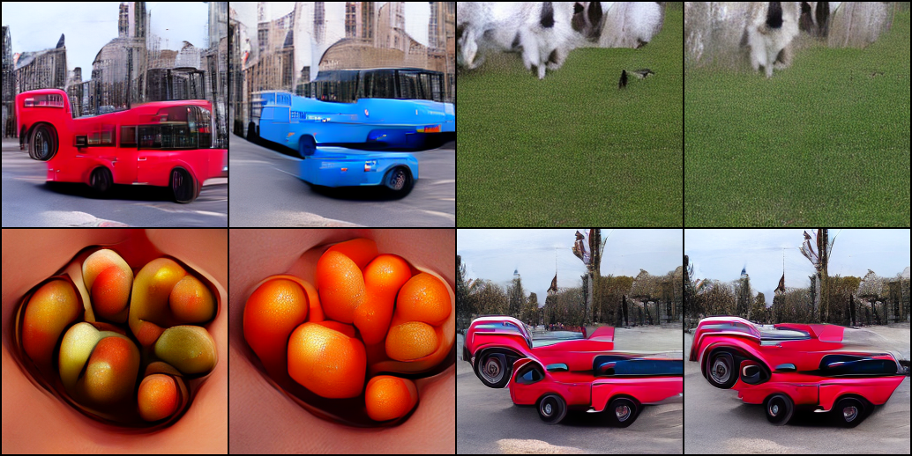
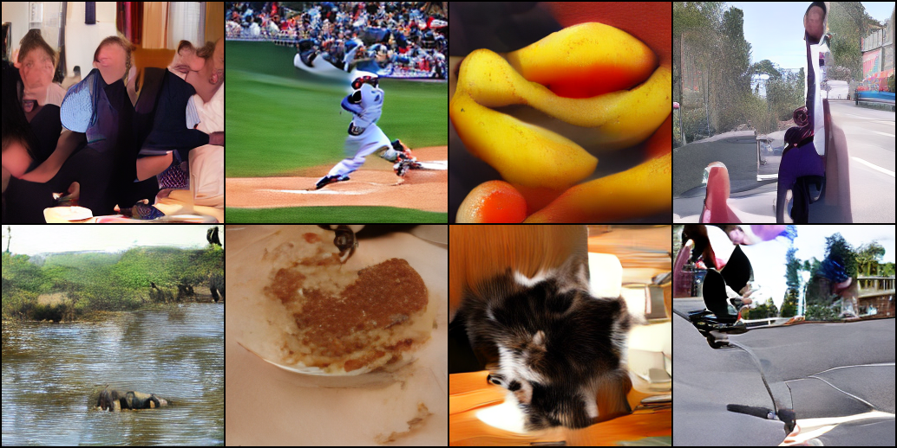

# COCO scratch denoiser and CIFAR consistency refinement

These experiments started on October 5, 2026. The configured training budgets and evaluation jobs have completed.
The previous LoRA and consistency results remain valid historical baselines.
The completed reports below record the observed quality and limitations; a completed budget is not a universal quality guarantee.

Local progress is recorded in `outputs/completion_studies/status.json` and the
individual training `history.json`/`execution.log` files. A local runner adopts
the already-started jobs, saves immutable CIFAR milestones, queues teacher-free
CIFAR iCT after CD, and runs selection/final evaluations before exporting the
final study. Failures are recorded explicitly in the status file. The queued
workflow is not evidence that those future runs have already completed.

## What is trained from scratch

The [COCO preset](../configs/text_coco_scratch.yaml) randomly initializes the
complete residual denoiser with self-attention and text cross-attention.
Its image codec and CLIP text encoder are pretrained and frozen. This is
scratch **denoiser** training in a pretrained latent/text representation;
end-to-end training of the codec and language encoder is a different experiment.
It is independent of the previously trained pretrained-denoiser LoRA adapter.

The 256px model has 73,799,044 trainable parameters. The initial run uses two
L40S GPUs, batch 8 per rank with two accumulation steps: effective batch 32.
Its configured 100,000 updates expose 3.2M image-caption pairs, approximately
27 COCO training-image passes. Captions are randomly selected from each
image's available descriptions. Empty captions occur with probability 0.1.
The first benchmark measured approximately 0.36 seconds/update; throughput
can change during longer training, checkpoint saves or concurrent evaluation.

The native epsilon objective uses the frozen base scheduler's scaled-linear
betas and Min-SNR weighting with gamma 5. The codec normalization remains
the pretrained codec's convention. Time conditioning uses positional
embeddings at `(discrete_index+1)`, expressed in code as normalized time
multiplied by 1000. Resuming requires the same rank count and compatible
configuration; optimizer, online/EMA weights and per-rank RNG/data positions
are saved. Ten-thousand-update checkpoints are retained as milestones.

For evaluation, keep the first 1,000 sorted COCO validation IDs for selection
and the remaining 4,000 for final diagnostics. Select a CFG scale on validation,
then report the final scale and sample counts. Generated-image CLIP similarity,
matched contrast prompts and image FID answer different questions. A caption
denoising diagnostic tests whether paired text helps more than empty/shuffled
text on identical corruptions. Visual inspection must still assess artifacts,
anatomy, counting and spatial relations. External pretraining overlap with
COCO is unknown, and center cropping can remove described objects.

## What changes for CIFAR

The [CD preset](../configs/image_cd_refined.yaml) keeps the frozen 100k-update
EDM teacher, architecture and class-label conditioning. It changes uniform
MSE to noise-weighted MSE and separates target EMA (0.95) from generation
EMA (0.9999). A 4k-update pilot precedes the configured 40k-update budget.
Batch 64 with two accumulation steps gives 128 images/update. Explicit
sigma schedules and clipping before re-noising are evaluated separately.

[Consistency theory and commands](10_consistency_models.md) explain the
objective and the optional sampler changes. The comparison tool freezes
checkpoints and uses matched selection/final reference counts, generation
seeds and actual call budgets. Several changes tested together are a recipe
comparison, not an attribution of causality to any single modification.
One training seed cannot establish reproducibility across training seeds.
Historical use of CIFAR test data during development is disclosed.

## Reproduce and inspect

### Intermediate checks, not final results

At 4,000 training updates, the candidate's one/two/four-call diagnostics use
1,000 generated and 1,000 reference CIFAR images with sampling seed 123.
These schedules have not undergone the final selection/evaluation protocol.

| Calls | Sigma levels | Clip before re-noising | FID, 1k/1k | IS |
|---:|---|---|---:|---:|
| 1 | [80] | yes | 63.45 | 7.24 |
| 2 | [80,1] | yes | 73.96 | 6.97 |
| 4 | [80,3,1,0.3] | yes | 55.16 | 8.02 |

The four-call pilot beats this pilot's one-call result. This is encouraging,
but small-sample FID is biased and does not establish the final quality or
which training modification caused the change. The exact
[four-call report](../assets/studies/scratch_refinement_pilot/cd_pilot_4/metrics.json)
and first eight generated images per class are retained:



The scratch COCO checkpoint at 1,000 updates generates fragmented imagery:
it is an early learning example rather than a showcase. All eight prompts
use the same initial noise, 30 DDIM steps and CFG 3. The saved
[conditioning diagnostic](../assets/studies/scratch_refinement_pilot/coco_scratch_step1000_denoising/metrics.json)
finds small positive mean paired-caption benefits on 64 held-out corruptions;
these alone do not demonstrate strong generation or prompt adherence.



```bash
torchrun --standalone --nproc_per_node=2 -m diffusion_lab.text_train \
  --config-name=text_coco_scratch
python -m diffusion_lab.image_train --config-name=image_cd_refined device=cuda:2
```

See [text training and evaluation](24_text_conditioning.md) and
[the comparison tool](../scripts/compare_consistency_refinement.py).
The [COCO cluster template](../slurm/train_coco_scratch.sbatch) uses three ranks;
that changes effective batch size to 48 and is a separate training setup from
the current two-rank run. The [CIFAR template](../slurm/train_cifar_consistency.sbatch)
uses one GPU. Create `slurm/logs` before submitting and set the external data,
base-component and teacher paths for your machine.

Raw training state, sample tensors and checkpoints stay under ignored
`outputs/`. Curated metrics and representative galleries should enter
`assets/` only after evaluation, with incomplete/weak cases explicitly labeled.
The v0.4 archives previously built in `dist/` represent the earlier reviewed
source; they must be rebuilt after these changes and final checks.

## Quality review, October 6: improvement is mixed

The interim review below used the 60k COCO milestone while training was running.
The 40k-update CD and iCT comparisons and the final 100k COCO evaluation have
since completed, as recorded below. The overall showcase-quality goal remains unmet.

All CIFAR rows below use 5,000 reference and 5,000 generated images, generation
seed 124 and class CFG 1. Sigma levels and clipping were selected independently
on 1,000 different reference examples with seed 123. Counts are actual student
calls. Different schedules and training recipes are compared, rather than
isolating one modification's causal effect.

| Calls | Old CD, 30k updates: FID | Revised CD, 40k updates: FID | New iCT, 40k updates: FID |
|---:|---:|---:|---:|
| 1 | 27.66 | 24.27 | 62.57 |
| 2 | 34.20 | 42.58 | 47.32 |
| 4 | 105.62 | 100.57 | 43.10 |

Lower FID is better. Revised CD improves one-call generation modestly but
worsens the two-call result; four-call CD remains weak. iCT benefits from
refinement within its own model, but even four calls trail the revised
one-call CD student. The encouraging 4k pilot did not establish a durable
full-budget distillation-refinement improvement. Existing 10k/10k diffusion
headline scores use a different sample-count protocol and are not directly
comparable to this table.

Exact [CD comparison](../assets/studies/scratch_refinement_progress/cd_vs_old/metrics.json)
and [iCT comparison](../assets/studies/scratch_refinement_progress/ict_vs_cd/metrics.json)
reports retain sigma levels, clipping, IS and checkpoint hashes.

For COCO, CLIP cosine on the same 64 validation captions at CFG 5 improves
from **0.2072 at 20k** to **0.2174 at 60k** updates. The matched difference is
+0.0102, with a caption-wise 95% interval [0.0027, 0.0176]. This interval
describes variation across those captions, not independent training seeds.
The completed 100k held-out evaluation is reported in the next section; it uses
different captions and the selected CFG 7.5, so its CLIP mean is not a matched
comparison with these 64-caption CFG 5 results.

The same-noise prompt gallery shows clearer buses and fruit, but dogs still
have distorted anatomy and the cyclist/car prompts remain poorly realized.
Improved CLIP alignment is insufficient to claim strong generation quality.



The [quality-review record](../assets/studies/scratch_refinement_progress/quality_review.json)
explicitly marks the quality goal as unmet. These results belong in measured
educational progress and limitations, rather than being presented as a strong
text-to-image or few-step benchmark.

## Completed evaluation reports

Each model has one training seed. Selection and final protocols are separated.

The final galleries were visually inspected on October 6. The 100k prompt
examples respond to bus color and fruit category, but buses and cars have
duplicated or malformed geometry, dogs have severely distorted anatomy, and
cyclist prompts fail to show the requested cyclist. The first eight held-out
samples include recognizable fruit, baseball and cat subjects, alongside
distorted people, animal anatomy and skateboard geometry. These are the first
examples in saved order, rather than a gallery selected for appearance.

COCO final evaluation uses 2,048 reference and 2,048 generated images at 256px,
30 DDIM steps and CFG 7.5: **FID 53.64**, **IS 19.93**, and mean CLIP cosine
**0.2218**. The denoiser was randomly initialized; its VAE and text encoder were
frozen pretrained components. The final metrics and visible failures do not
establish strong text-to-image quality. CIFAR one-call CD improves FID from
27.66 to 24.27 on matched 5k/5k evaluation, but samples remain blurry and
multi-call CD refinement remains weak. The four-call iCT model reaches FID
43.10 and does not surpass the one-call CD model.

The final checks passed 120 tests and the documentation/publication audits.
These checks verify the implementation and public file set, not generation
quality. The [final visual-review record](../assets/studies/scratch_refinement/quality_review.json)
keeps the quality goal explicitly marked as unmet.

| Comparison | Candidate calls | Candidate FID | Baseline FID | Candidate IS |
|---|---:|---:|---:|---:|
| cd_vs_old | 1 | 24.27 | 27.66 | 7.67 |
| cd_vs_old | 2 | 42.58 | 34.20 | 7.83 |
| cd_vs_old | 4 | 100.57 | 105.62 | 5.89 |
| ict_vs_cd | 1 | 62.57 | 24.27 | 5.57 |
| ict_vs_cd | 2 | 47.32 | 42.58 | 6.40 |
| ict_vs_cd | 4 | 43.10 | 100.57 | 6.65 |

[cd_vs_old protocol and scores](../assets/studies/scratch_refinement/cd_vs_old/metrics.json)
[ict_vs_cd protocol and scores](../assets/studies/scratch_refinement/ict_vs_cd/metrics.json)

| Text case | Updates | CFG | CLIP paired mean | CLIP paired − mismatched | FID |
|---|---:|---:|---:|---:|---:|
| text_step0100000_validation_cfg1 | 100000 | 1.0 | 0.1621 | 0.0330 | — |
| text_step0100000_validation_cfg3 | 100000 | 3.0 | 0.2012 | 0.0800 | — |
| text_step0100000_validation_cfg5 | 100000 | 5.0 | 0.2144 | 0.0988 | — |
| text_step0100000_validation_cfg7.5 | 100000 | 7.5 | 0.2236 | 0.1084 | — |
| text_step0100000_prompts | 100000 | 7.5 | 0.2273 | 0.0636 | — |
| text_final_heldout | 100000 | 7.5 | 0.2218 | 0.1083 | 53.64 |



















CLIP is a coarse semantic diagnostic. Visual quality, counting and spatial binding require separate interpretation.
Call-budget comparisons use their recorded sample counts; historical scores with different counts should not be compared directly.
Release packaging and external checkpoint hosting remain separate from these training results.
