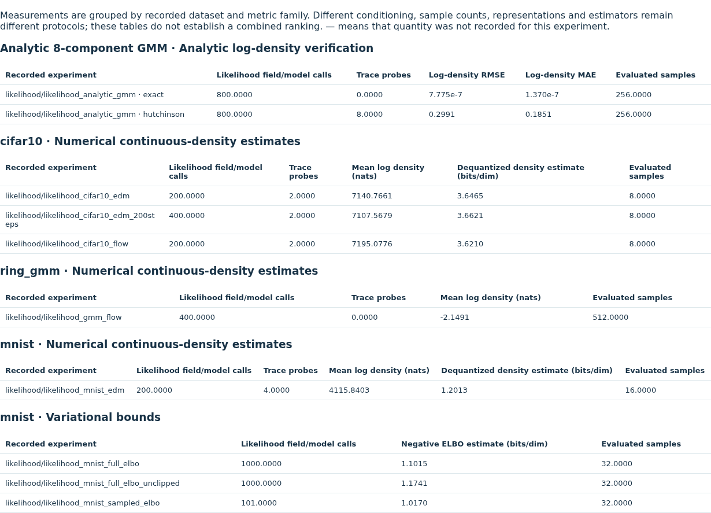
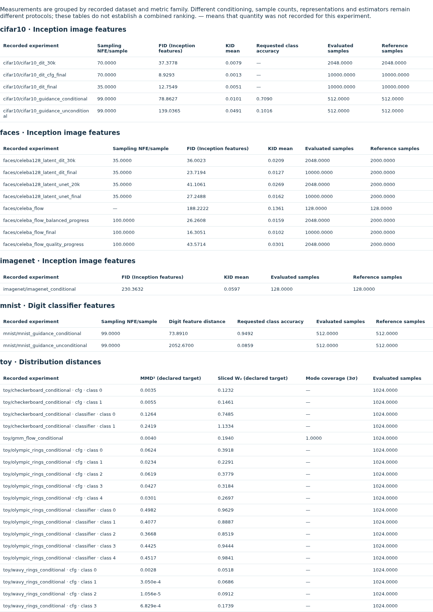

# User interaction audit

The explorer was exercised in Chromium over a local HTTP server, using the same
file layout as a normal browser preview. The audit selects every enabled finite
combination of dropdown values, including dependent model, fitting-seed and image
choices. It checks slider endpoints and middle values; short discrete sliders
with at most thirteen positions are checked at every position. Multiple sliders
are checked jointly on that grid. This is a finite validation grid, rather than a
claim to test every possible continuous parameter or browser implementation.

At each selection, the checker verifies that visible images load, their HTTP
bytes match the repository assets, local evidence links exist, tables have data,
and JavaScript produces no errors or invalid numeric text. The local numerical
oracle checks selected fields and asset associations against the embedded
scientific evidence. The lab-specific validators independently bind that evidence
to source records and numerical arrays. A 390-pixel viewport is checked in each
concept area.

From the repository root, with the usual package/development dependencies installed:

```bash
python -m pip install playwright==1.63.0
python -m playwright install chromium
python scripts/check_demo_controls.py
python scripts/check_explorer_browser.py
```

The HTTP checker starts and stops its own temporary localhost server and does not
use the ports of existing preview servers. Playwright and Chromium are development
verification tools; viewers only need a browser. `PLAYWRIGHT_BROWSERS_PATH` can
point to a personal external browser cache.

[HTTP interaction results](demo_controls_validation.json) list the exact tested
selector combinations, slider-check count, image files and local links.
[Scientific browser results](explorer_browser_validation.json) record the separate
numerical oracle checks. The reports identify the tested HTML by its SHA-256 digest.
After changing HTML or assets, rerun the relevant checks before publishing.

## Corrected metric presentation

The earlier likelihood comparison mistakenly reused sampling-distance columns,
leaving its rows empty. Tables now use the actual recorded metric schema. The
checker anchors the CIFAR-10 likelihood regression directly to its source JSON,
then verifies every applicable comparison row and selected detail field.

- Analytic density verification shows log-density errors and trace probes.
- Continuous-density estimates show recorded calls, log density and dequantized
  bits per dimension; these remain numerical estimates under the recorded protocol.
- Negative ELBO estimates are shown separately as variational bounds.
- FID, KID, digit feature distances and paired caption alignment have their own
  dataset/representation groups. Generated/reference sample counts are explicit.
- Nested analytic results and per-class result lists are expanded into distinct
  records. Illustrative lessons state that no fitted comparison is available.

A dash means the original experiment did not record that quantity. Different
conditioning, representations, sample counts or estimators do not establish a
combined model ranking. Original historical validity warnings remain visible.
No measurement or generated sample was changed to fill missing cells.





The [metric disclosure check](demo_details_validation.json) opens and closes every
complete-record panel and compares its displayed JSON to the selected source:

```bash
python scripts/check_demo_details.py
python scripts/validate_release.py
```
